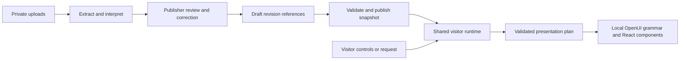

# Architecture

Studio turns publisher material into reviewed knowledge and media, then publishes a snapshot that the visitor runtime can arrange around the visitor's task. The host owns ingestion, persistence, identity, provider access and publication. The shared React package owns the semantic rendering vocabulary and interaction behavior. See [product philosophy](product-philosophy.md) for the product direction and [platform foundation](platform-foundation.md) for the current pilot scope.

## Visitor surfaces

`WebsiteSurface` renders the independent published website. `VisitorAssistant` keeps the top waveform/chat dock and opens one evolving information card above an inert, softened website. `VisitorWorkspace` composes validated semantic regions and owns bounded request-state history, Back, reading position and stable media identity. Voice and chat share acknowledged composition context and server-resolved published facts. See the [information surface](information-surface.md) for state, responsive layout, motion, restoration and verification.

Editorial, Showcase and Clarity are compositions in shared `PublishedWebsite`, driven by `@thevoice/platform-ui/site-design` contracts and tokens. Branding previews use actual draft content. Existing snapshots without a template now resolve their regular website renderer from their saved layout (Editorial for editorial, Clarity otherwise); saved branding, publication data and assistant tokens remain unchanged. Explicit template choices retain precedence. Switching/resetting styling does not reimport content or alter the publication. See [templates and source lifecycle](templates-and-source-lifecycle.md) for schemas, fonts, compatibility and visual evidence.

The [regular website refinement](website-design-and-motion.md) uses `website.css` under an explicit website opt-in, and `website-motion.ts` for once-only entrances and bounded image scrolling. `style.websiteMotion` is optional (Subtle by default), independent of shared theme tokens and assistant motion. `WebsiteSurface` forwards the assistant's existing open state as an animation suspension flag; it does not unmount the website. Observers use the nearest scrolling ancestor, including Studio's preview. Native HTML and scrolling remain the baseline.

## Code map

| Boundary | Main files |
| --- | --- |
| Studio and review | [Dashboard](../components/Dashboard.tsx), [KnowledgeReview](../components/KnowledgeReview.tsx), [MediaPanel](../components/MediaPanel.tsx), [OpeningSettings](../components/OpeningSettings.tsx) |
| Templates and Branding | [BrandingPanel](../components/BrandingPanel.tsx), [shared design contract](../packages/platform-ui/src/site-design.ts), [PublishedWebsite](../packages/platform-ui/src/PublishedWebsite.tsx), [canonical composition](../lib/website-presentation.ts) |
| Regular website motion and styling | [website-only effects](../packages/platform-ui/src/website-motion.ts), [scoped website CSS](../packages/platform-ui/src/website.css), [WebsiteSurface and native details](../components/WebsiteSurface.tsx), [design and verification](website-design-and-motion.md) |
| Website migration | [crawler](../lib/website-import.ts), [pinned transport](../lib/website-fetch.ts), [private design/report schema](../lib/website-import-model.ts), [workflow and limits](website-import.md) |
| Source ingestion and corrections | [source-extractors](../lib/source-extractors.ts), [ingestion](../lib/ingestion.ts), [knowledge-model](../lib/knowledge-model.ts), [knowledge-store](../lib/knowledge-store.ts) |
| Photo preparation and review | [image-processing](../lib/image-processing.ts), [media-interpretation](../lib/media-interpretation.ts), [media-store](../lib/media-store.ts) |
| Site persistence and publication | [site-model](../lib/site-model.ts), [site-store](../lib/site-store.ts), [site-commands](../lib/site-commands.ts), [site API](../app/api/sites/[siteId]/route.ts) |
| Shared schemas and renderer | [contracts](../packages/platform-ui/src/contracts.ts), [media contract](../packages/platform-ui/src/media.ts), [Runtime](../packages/platform-ui/src/Runtime.tsx), [components](../packages/platform-ui/src/components.tsx), [MediaViews](../packages/platform-ui/src/MediaViews.tsx) |
| Visitor host and provider boundary | [SiteExperience](../components/SiteExperience.tsx), [VisitorAssistant](../components/VisitorAssistant.tsx), [visitor API](../app/api/visitor/[slug]/route.ts), [catalog-presentation](../lib/catalog-presentation.ts), [visitor-provider](../lib/visitor-provider.ts) |
| Access, usage and observations | [session](../lib/firebase/session.ts), [visitor-store](../lib/visitor-store.ts), [visitor-quota](../lib/visitor-quota.ts), [platform-events](../lib/platform-events.ts) |
| Launch billing | [ledger](../lib/billing-ledger.ts), [versioned rates](../lib/billing-rates.ts), [local preview](../lib/billing-store.ts), [Stripe transport](../lib/billing-stripe.ts), [Stripe transactions](../lib/billing-stripe-store.ts), [routing](../lib/launch-billing.ts) |

## Knowledge: upload → review → publication

Uploads pass ownership, revision, byte-type and size checks in [file-validation](../lib/file-validation.ts) before becoming private site files. CSV, compatible multi-sheet XLSX tables and explicit key/value TXT/DOCX/HTML records have deterministic parsers. Text PDFs use local PDF.js; image OCR has local/managed injectable adapters, not a deployed service. Scanned PDF pages fail explicitly. A website import validates DNS and pins/checks the actual public HTTPS destination without redirects or credentials. Bounded fragments share one extraction/provider budget; free prose requires the optional interpreter. Unsupported or oversized sources fail explicitly, not as complete-looking partial catalogs.

The reusable `KnowledgeCatalog` keeps schema version 1 with additive optional facts, aliases/identifiers, conditions, polarity, source-stated certainty and valid/observation time. Individually typed `properties.*` facts preserve singleton addresses, emails and policies separately from shared comparison attributes. Unknown remains `null`; conflicts and conditions are not flattened. Source filenames, hashes, baselines, row/line/page/cell excerpts, field/assertion evidence, identity suggestions and correction history belong to private `KnowledgeArtifact`, never the public projection. Hash-bound assertion reviews require explicit decisions for unsupported claims; anchor existence is not entailment. See [semantic architecture](semantic-graph-architecture.md) and [the consumer handoff](semantic-workspace-handoff.md).

An import creates a saved candidate with a review status, source hash, base draft hash and claim token. Reimporting identical source bytes creates no duplicate entities or model call. Changed sources with the same normalized filename and stable record IDs preserve publisher corrections while updating untouched source values. Explicit replacement supports renamed files without changing the original item namespace. Review compares previous/current/incoming values and retains missing items by default. Decisions select saved alternatives through candidate revision checks; the client cannot submit new source values or citations. Shared private pools avoid repeating full excerpts and restoration context per field. This is bounded merge logic, not general semantic identity resolution across arbitrary documents. See [Source review and updates](source-review.md).

One related-file job accepts up to six sources, reports each result and checkpoints successful merges. Related prose shares one existing quota reservation and provider request with file-specific evidence validation and a combined 60,000-character/400 KB evidence limit. A failed file retains its previous contribution; partial Apply requires explicit acknowledgement. Source withdrawal uses the same candidate workflow through `source-lifecycle.ts`: remaining field/fact support and publisher corrections survive, retired origins prevent resurrection, and existing Apply reconciles media/opening references. Empty catalogs are valid for deliberate final-source withdrawal; empty extraction is still rejected.

Publishers can edit the candidate directly or use conversational corrections. Exact-name rename and attribute changes work locally; broader corrections require the connected interpreter. Corrections create new immutable candidate artifacts and supersede affected source suggestions. Apply checks the current source, candidate revision when supplied, draft and claim before changing the draft knowledge reference. When items are removed, it also installs a new media revision with their item associations removed and prunes invalid opening selections; photo assets and albums remain. One draft history entry restores these together on Undo. Superseded work cannot overwrite a later correction or draft. The cloud transaction checks the claim with the site mutation; the local backend serializes that boundary. [Source review tests](../tests/knowledge-review.test.ts), [knowledge tests](../tests/knowledge-store.test.ts) and [mocked cloud tests](../tests/knowledge-cloud.test.ts) cover these paths.

Knowledge and media use independent revision references in `SiteContent`. Publish validates opening references and media associations, stages immutable public projections, then changes the published site snapshot under the site revision check. A staged projection is still inaccessible through public routes until it matches the current publication. Undo changes the draft; republishing is required to change visitor content.

Knowledge does not imply capabilities. The current catalog capability contract permits explicitly registered HTTPS navigation links with entity scope. Ingestion creates no capabilities, and model display plans can reference only registered IDs. There is no implemented inventory, reservation, checkout or other executable integration in this slice.

## Photos and albums

Photos remain within Studio's Files workflow and work before a catalog exists. A `MediaLibrary` holds assets, ordered albums and explicit site/entity/section associations, including actual-subject versus example roles. One photo can belong to multiple albums and targets. Dimensions come from stored image metadata; review requests cannot invent them.

New uploads are decoded, orientation-corrected and re-encoded into metadata-free WebP display and thumbnail variants. Originals remain private. Selected IPTC/XMP description and credit fields can become review metadata, and publishers control the final caption, alt text and credit. Local suggestions use supplied text and metadata. The separate **Suggest from photos** action optionally sends a bounded selected batch of sanitized thumbnails to the connected provider and returns a review proposal.

Apply creates an immutable private media revision and updates the draft. The current publication carries an image allowlist, so [public image requests](../app/api/public-files/[slug]/[fileId]/route.ts) serve only its approved images or chosen logo. Storage paths and original bytes do not enter model plans or the shared media contract. The host supplies an asset URL resolver to `MediaProvider`; the shared package renders galleries, contextual imagery and the keyboard-accessible viewer. See [Photos and albums](photo-library.md) for the complete workflow and deletion rules.

## Shared runtime and interaction

### Current visitor host: adaptive workspace (assignment 2)

The integrated visitor now uses `VisitorWorkspace` and shared `AdaptiveWorkspace`, with `/workspace` pure contracts. It retains up to twelve independently addressable objects with per-object state, atomic validated operations and actual DOM-derived scene context. Catalog, photo, source, contact, comparison and accepted external content share focus/return without replacing unrelated objects. The complete implemented contract, revision/ACK lifecycle, graph mapping, three style presets/palettes and publisher greeting points are documented in [adaptive workspace architecture](adaptive-workspace-architecture.md); verification and remaining limitations are in its [acceptance ledger](adaptive-workspace-acceptance.md).

The following paragraphs describe the retained v1/OpenUI compatibility renderer and earlier single-presentation host. They are not the active visitor's one-object limit: legacy plans are lifted into additive workspace operations, v1 explicitly supports an instance-identity opt-in, focused objects use symmetric 800 ms center/return travel without page auto-scroll, and no-catalog sites use the same workspace. Intro-only opening now omits unrequested content rather than placing it below the fold. Voice/chat activation is separate from content invocation.

### Retained presentation compatibility and shared foundations

`@thevoice/platform-ui` is a portable ESM workspace package. React exports live at the package root; `/contracts`, `/catalog`, `/interaction`, `/media` and `/knowledge` expose pure contracts and helpers, and `/styles.css` supplies the design vocabulary. It has no dependency on Next.js, Firebase, Studio storage or provider credentials. Its [package manifest](../packages/platform-ui/package.json) and [separate-consumer check](../scripts/verify-platform-package.mjs) define and verify that boundary.

The following paragraphs describe the retained legacy renderer and default v1 compatibility contract used by `/lab` and older plan callers. They do not describe the new visitor's object lifecycle or focus timing; those use `/workspace` and the adaptive implementation above. Sites without a catalog also use the adaptive workspace, with source/fact references rather than a separate single active panel.

The host's `retrievePublishedKnowledge` authorizes a full approved snapshot before applying a bounded query/as-of projection. Current public page, typing and voice-session routes likewise load the full snapshot so qualified relationships survive; `knowledgeFacts` shares individual legacy-attribute references with the workspace. Deterministic lexical/typed/graph retrieval returns entities, singleton facts, relationships, reviewed media, conditions, unknown/conflict status and explicit omitted counts. `catalogPresentationContext` exercises that boundary in the existing provider path; it no longer sends the full growing graph per turn. Legacy cards use approved current-time attribute projection, while typed replies can answer matched singleton properties. The adaptive workspace uses this boundary without graph/vector infrastructure.

A `PresentationPlan` selects bounded components and compatible variants by catalog/media IDs: collection, detail, comparison, selection, relationships, actions and gallery. Its operation names describe discover, understand, narrow, compare, decide or act; these are available operations, not a required wizard. The plan also identifies the catalog snapshot and a semantic transition. Optional validated `stateUpdate.filters` replaces filters atomically with the accepted plan; an empty list explicitly resets them, while omission preserves existing constraints. Published attribute types and compatible operators are checked before application, and Back restores the prior filters and view. Each component type has one stable slot, detail has one entity, and comparison requires two to six entities and at least one declared attribute. Provider instructions also request meaningful shared attributes; the structural validator does not establish the usefulness of a comparison.

The host validates provider envelopes and references. The browser validates again, then [compiles](../packages/platform-ui/src/compile.ts) the plan into local OpenUI statements, runs a bounded [preflight](../packages/platform-ui/src/preflight.ts), parses them with the real OpenUI parser and renders registered React components. OpenUI is the rendering grammar; it does not supply the platform's visual identity. The model generates neither arbitrary markup/styles nor executable callbacks. OpenUI Gateway is not a runtime dependency.

`CatalogExplorer` owns filters, selected IDs, focus, visible entity IDs and bounded view history. Manual filtering, selection, comparison, detail, restoration and photo viewing work without model calls. A pending response is cancelled or ignored after newer manual interaction; the host keeps an active voice connection and reports the new validated state. Malformed, stale and unsupported plans preserve the accepted view. An initial supplied plan does not create a Back step, and equivalent later views do not duplicate history. External request/thinking state drives the same truthful pending status without disabling manual browsing. Unknown numeric values do not pass numeric filters. Explicit empty gallery selections cannot become all photos. Empty collection references have a distinct documented meaning: all members of the scoped collection or catalog.

The [motion vocabulary](../packages/platform-ui/src/motion.tsx) owns reveal (380 ms), disclosure (450 ms), reflow (480 ms), workspace/focus/restore (520 ms) and exit (180 ms). Persistent components retain identity; disclosure height moves surrounding layout, and exiting controls become inert immediately. Reduced motion removes movement. Requested destinations across registered component types, and legacy source presentations, wait for settled geometry with a 900 ms guard before scrolling only when offscreen; user input cancels that pending reveal. Reduced motion still waits for layout stability but uses instant scrolling. Heading targets and nearest alignment account for nested preview panes without transferring focus. Internal catalog layout uses container width, so embedded narrow previews receive the same responsive layout as narrow pages. [Motion browser tests](../tests/browser/motion.spec.ts) inspect intermediate geometry and interruption behavior.

The retained [SitePresentation](../components/SitePresentation.tsx) supports legacy callers with a smaller source-selection plan. Current sites without a catalog use `VisitorWorkspace` information and photo objects. New sites currently default to Voice only; publishers can choose chat or both, and ordinary visual browsing requires neither voice nor AI. Voice errors and exhausted voice offer independently capped typing fallback, including on voice-preferred sites. See [visitor conversations](visitor-conversations.md) for lifecycle and fallback behavior.

## Optional direct model access

The default demo backend and Studio visitor preview use deterministic behavior and cannot call paid model APIs, even if a key exists in the environment. Connected generation requires Firebase workspace mode plus the explicit OpenAI mode and server configuration. Configuration availability is not proof of a working live connection. See the existing [Firebase setup](firebase-setup.md) and [AI editor setup](ai-editor-setup.md) guides.

Owner text edits, knowledge and photo interpretation, typed visitor requests, research and delegated voice work use Responses with GPT-6 Astra and high reasoning. Continuous visitor voice uses the [GPT-Live architecture](gpt-live.md): audio-only WebRTC, a server sideband, and selective client delegation. Live can answer from its current published reference context or reliable general knowledge; missing facts, careful calculations, research and display actions use the backend. The independent FlowPath app has a separate copy of the core; Studio's model migration does not update that checkout. Browser readiness gates the greeting; validated published content and current UI state feed backend tools. Manual changes abort stale work while the voice session stays connected. Browser audio activity drives waveform state and iOS startup protection.

Source material remains untrusted data. Visitors receive only published information, bounded current-view context and ephemeral history. Original transcript fragments supply delegated request context; fragments are not completed semantic turns. GPT-Live session duration and Astra token usage are measured separately. Live sessions use `store:false`, which is not a zero-retention guarantee. See [GPT-Live](gpt-live.md) for exact transport, limits and live-verification boundaries.

## Persistence, isolation and limits

An optional [Search and explore](search-and-explore.md) path extends visitor interaction with external web/image results and approximate map overviews. It is off by default and separately published. Its host components and bounded external-result contract do not mutate the published catalog. Typed and continuous voice searches share the same transactional allowance and provider adapter; voice view changes wait for browser acknowledgment. The default published-only behavior above remains unchanged when this capability is disabled.

[site-store](../lib/site-store.ts) selects [local-store](../lib/local-store.ts) or [cloud-store](../lib/cloud-store.ts). Local demo state uses a serialized JSON-file queue, with knowledge/media artifacts and image variants in separate private data directories. It is a single demo owner, not a multi-user production backend. Firebase routes derive the owner UID from the verified session; server checks enforce site ownership and revisions. Browser Firestore/Storage access is denied by the included rules. Public pages receive the approved projection, not private source artifacts, editor messages or file storage credentials.

Continuous sessions use a server-private [control mailbox](../lib/visitor-realtime-mailbox.ts): Firebase stores the latest bounded application state in `voiceVisitorRealtime/{id}` and the call owner subscribes to that document, allowing control requests to arrive at other workers. The demo mailbox is explicitly single-process. A per-call expiring capability, publication checks, ordered revisions, at most 300 updates and eight normal updates per second bound this channel. A control POST stores desired state; the owning stream acknowledges actual application. Mailboxes hold no history, transcripts or audio; operational logs also omit conversation text. Normal close deletes the mailbox, expiry rejects later updates, and new sessions perform bounded expired-record cleanup. No scheduled cleanup or deployment configuration is added. This implementation does not establish deployed streaming lifetime or live Firebase permissions.

The current bounds are pilot constraints, not subscription entitlements:

| Area | Implemented bound / source |
| --- | --- |
| Uploads | 10 MB per photo or PDF, 2 MB per DOCX/XLSX/HTML, 256 KB per CSV/TXT; 100 photos + 20 other files; 100 MB total including photo originals and variants. [Validation](../lib/file-validation.ts) |
| Extraction | 40 PDF pages and 60,000 extracted characters; Office/HTML adapters are bounded; OCR uses an injectable local provider. [Extractor](../lib/source-extractors.ts) |
| Legacy v1 catalog | 100 entities, 24 attributes, 24 collections, 200 relationships, 12 jobs, 20 registered links; additional payload/depth/reference checks. [Contracts](../packages/platform-ui/src/contracts.ts) |
| Media | 100 assets, 24 albums, 300 associations; 40 million decoded pixels per upload. [Media schema](../packages/platform-ui/src/media.ts), [image processing](../lib/image-processing.ts) |
| Review and storage | 50 import/review jobs per site; 700,000-byte knowledge artifacts; 750,000-byte serialized cloud site state; up to 20 draft-history entries. [Knowledge store](../lib/knowledge-store.ts), [cloud store](../lib/cloud-store.ts), [local store](../lib/local-store.ts) |
| Connected owner generations | Shared across text edits, semantic interpretation/correction and photo interpretation: 10 attempts per owner and 100 globally per UTC day, plus owner cooldown and replay protection. [AI setup](ai-editor-setup.md) |
| Visitor attempts | Default 25 chat / 5 voice per site daily; deployment-wide 100 chat / 20 voice daily. Separate from owner generations. [Visitor guide](visitor-conversations.md) |
| Observations | Latest 200 events per site, with bounded IDs, timing, counts and provider-reported usage when present. [Event store](../lib/platform-events.ts) |

Recent activity distinguishes preview from public observations. Selections, photo opens and link clicks are observations, not verified business outcomes. Knowledge, media and visitor provider paths report measured tokens when available; the legacy text editor does not yet report its per-call token usage. Missing usage remains unknown. Production monetary enforcement/reconciliation and the complete acquisition-to-retention funnel are not activated. Manual browsing remains available when AI is unavailable or exhausted.

The launch billing implementation keeps subscriptions and AI credit in a separate ledger, with integer microdollars, monthly allowance windows, purchased-credit rollover, reservations and replay protection. Local synthetic billing uses an atomic serialized file under `billing-test`; enrolled local visitor requests exercise synthetic metering without model calls. Stripe test mode uses owner-authorized transactions in `voiceStripeTestBilling`, and saves an order before contacting Checkout. Provider calls occur outside transaction callbacks. Signed payment events validate the saved site/order/customer, amount and paid period before adding credit. Unknown payment/usage outcomes retain their reservations; test credit is never authorization for paid OpenAI traffic. The visitor and owner provider entry points reject sites enrolled in Stripe test billing. See [the launch offer](launch-offer.md) for configuration and remaining activation boundaries.

Uploads and immutable projections can be staged before the final revision-checked mutation. An ambiguous transport result can therefore leave a private orphan; the implementation avoids destructive cleanup of a potentially committed object. It has no automatic orphan cleanup worker. Published/draft/retained-history media references block deletion of images still in use.

## Verification and extension

Use Node 24 and the scripts in [package.json](../package.json). `npm run check` runs lint, types, persistent offline tests, the packed-package consumer and the production build. `npm run test:browser` then starts an isolated local demo server on port 3225 with disposable data and a fresh headless Playwright context; it does not use a signed-in browser profile. See [Playwright configuration](../playwright.config.ts).

The [synthetic fixture catalogs](../fixtures/README.md) cover structurally different domains. Keep fixtures, direct-provider mocks, storage/publication tests and browser interaction tests aligned when extending a contract. Offline checks cover real local extraction, image processing, OpenUI parsing and browser layout; mocked Firebase/provider transports do not establish live service configuration or model quality.

## Hierarchical visitor tasks (v2)

The [visitor task implementation report](visitor-task-system/implementation-report.md) maps the implemented hierarchy, query, publication and task contracts to code and verification. `catalog-repository` stages immutable bounded chunks and a validated manifest; the site draft/history/publication stores only its reference. Public v2 routes bypass full legacy catalog hydration. `catalog-query-index` compiles authorized scope, field, lexical and relationship indexes, while `catalog-query` evaluates typed criteria and produces bounded revision-bound pages. Canonical records can belong to multiple collections without duplicating facts.

`visitor-task-bridge` connects the existing chat/voice executor to one typed `visitor-capabilities` registry and session/evidence store. `VisitorTasks` provides the same operations for manual browsing, exact display acknowledgment, selections, artifact editing and synthetic action review. Current-publication authorization precedes index/record access; browser state is not evidence authority. Local/cloud transport contracts share CAS semantics, with cloud tested only through injection. The implementation retains the existing workspace, media authorization and Motion system. Full limits, memory accounting, v1 migration/rollback and unactivated vendor boundaries are documented in the report.
