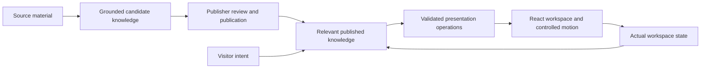

# Astra implementation sequence

Prepared September 12, 2026, from the current Studio checkout and the relevant task discussions. These are implementation assignments, not statements that the work is complete.

## Run order and task destinations

Use Astra for the following tasks. Run one implementation at a time against the checkout containing the existing changes; much of the current foundation is uncommitted. Starting from a clean `main` worktree may omit that foundation. Do not reset, stash away, or overwrite it to start these assignments.

| Order | Assignment | Destination |
| --- | --- | --- |
| 1 | [Semantic knowledge, ingestion, and retrieval](01-semantic-knowledge.md) | Continue `Copy-paste Codex prompt Use this prompt to ask a later Code…` (`01a0922e-7441-7170-a045-3f511ce626cf`). |
| 2 | [Adaptive interface, multiple open objects, and screen awareness](02-adaptive-workspace.md) | Continue `Implement only the first vertical slice from: docs/componen…` (`01a09124-db85-74d3-9acc-3f525693fd54`) after assignment 1 has documented and checked its handoff. This assignment expands the earlier first-slice limit. |
| 3 | [Independent integration review and fixes](03-integration-review.md) | Create one new Astra task after the first two finish, using the same completed implementation state. |

The earlier Motion, component-design, catalog-investigation, and surface-comparison tasks are reference material for assignment 2. They do not need to be additional concurrent writers. If continuing an existing task is inconvenient, each assignment also works as a new task after its prerequisites are present.

## Product outcome

Publishers supply information and identity. Studio extracts meaningful entities, facts, relationships, and media associations, makes the interpretation reviewable, and publishes approved knowledge. A visitor's request and current workspace determine which information and reusable components appear.

The durable graph, retrieval result, presentation request, and actual browser workspace are distinct. A requested presentation is not proof it rendered. Multiple objects can remain open even when only some are visible in the viewport.

## Verified starting points

- `lib/ingestion.ts` still instructs the interpreter to create a small reusable catalog and generally put one-off attributes into summaries. Existing typed facts and provenance provide a starting point for broader knowledge, but changing that instruction alone will not complete extraction, review, retrieval, or rendering.
- `packages/platform-ui/src/contracts.ts` supports several components in a plan, while requiring component identity to equal its type. `lib/catalog-presentation.ts` still carries a single focused entity/photo. This is partial composition support, not the requested independently addressable workspace.
- Screen context and browser acknowledgments already exist. Extend them, including the current GPT-Live application adapters; do not recreate voice transport from older Realtime-only discussions.
- Semantic ingestion and focus-return tasks reported offline checks, with some browser verification unfinished. Read the actual tests and rerun relevant checks; reports are not evidence of current integrated behavior.

## Shared execution rules

These assignments authorize local implementation and fixes in their stated scope. Give a short plan, then proceed through code, integration, tests, and documentation without another routine approval checkpoint. Do not stop at an audit, proposal, skeleton, or first slice when the remaining work is locally feasible. If something depends on an unavailable external service or permission, finish independent work and report the exact unresolved boundary honestly.

Read repository instructions and the current code before editing. Capture the baseline and preserve unrelated changes. Reuse the existing shared package, Motion, typed validation, publication boundaries, and provider adapters. Keep internal TheVoice/package identifiers. Do not alter the independent FlowPath news app in these assignments.

Use synthetic data and offline/mocked providers. Do not read secrets or private publisher content, change billing/auth/deployment configuration, make live paid calls, start emulators, deploy, commit, push, or publish packages. Live quality testing is a separate explicitly budgeted activity. Shared GPT-Live core changes are outside these Studio assignments; use host adapters and report any proven core limitation.

## Scope and handoffs

Assignment 1 owns ingestion, canonical knowledge, correction/identity behavior, publication-safe retrieval, and its shared data contracts. It supplies an executable, tested graph-to-presentation boundary and concrete examples for assignment 2. It does not build the visitor workspace.

Assignment 2 consumes that boundary and owns presentation operations, workspace state, screen context, visitor/voice integration, reusable component behavior, visual quality, basic style choices, and the publisher-selected greeting. It may make compatibility changes at the handoff boundary, with the reasons and tests documented.

Assignment 3 independently validates the combined result and fixes defects. It must not weaken assertions or redefine acceptance to make the implementation appear complete.

The active batch covers to-do items 4–9, the semantic-graph expansion, and the three-point greeting; it preserves and uses the recovered FlowPath branding. Legal/business formation, Stripe production activation, and subdomains/custom domains remain separate work. These prompts do not complete those items.

Maintain an acceptance ledger in the implementation handoffs: requirement, implementation location, verification evidence, and remaining limitation. Distinguish implemented locally, verified offline, verified in a browser, and live-provider quality unverified. Reconcile outdated architecture statements as implementation changes.
