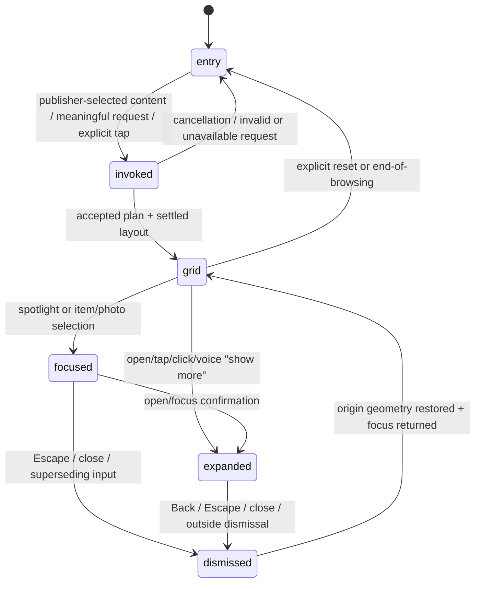

# Catalog experience investigation: items 6–8

Status: investigation and implementation recommendation only. This document does not authorize or implement the broad interaction change.

Implementation update (assignment 2): the later explicit assignment superseded the original first-slice limit and authorized the integrated [adaptive workspace](adaptive-workspace-architecture.md). Published catalog/media authority remains separate, but visitor references share an index and multi-object coordinator. Intro-only opening, explicit browse, entity/photo/source/fact objects, nested focus/return, per-object filters/reading state, actual scene awareness and applied/failed/cancelled voice acknowledgments are implemented. The assessment and phases below are historical reviewed design input, not a description of the current single-slot visitor. Annotated media and diagrams remain deferred; [the acceptance ledger](adaptive-workspace-acceptance.md) records offline evidence and unverified live behavior.

Scope: integrate published photos with catalog browsing, gate non-intro content until meaningful invocation, and bring catalog interactions up to the quality bar already established by the chat and voice surfaces. The separate Motion investigation owns exact timing/library decisions; the separate component-system investigation owns the broader taxonomy and interaction vocabulary. This proposal uses the current architecture and leaves those decisions as explicit integration seams.

## Recommendation

Keep the current authority boundaries and make the visitor surface, rather than the provider or source models, responsible for the unified experience.

1. Treat the initial page as an `OpeningSurface`, not as a default catalog view. It contains the publisher-selected introduction and only the explicitly selected opening content. The catalog, contact details, sections, albums and photos are not mounted as visitor content until a meaningful request or explicit opening selection occurs.
2. Keep `KnowledgeCatalog` and `MediaLibrary` as separate published revisions, but expose them through one host-built published-content index and one shared surface coordinator. A photo remains a media asset with explicit associations; it becomes a first-class presentation reference without becoming a catalog entity or a business capability.
3. Make focused/expanded state runtime-owned. A click, tap, typed request or voice command should enter the same state machine and use the same `LayoutGroup`, focus, backdrop, interruption and return behavior. The model continues to select validated components and references; it does not select animation or generate markup.
4. Reuse the existing `ConversationDock`, `VisitorVoiceStage`, `motion.tsx` roles, `CatalogExplorer` history/cancellation, and `MediaViews` image resolution. Add only the missing shared focus coordinator and the smallest state/visibility contracts needed to connect them.

The main defect is composition and orchestration, not an unsafe media or catalog data model. Published-reference validation, immutable revisions, example-photo labeling and server-owned provider boundaries are already strong and should remain unchanged.

## Current-state assessment

### Authority and publication

- `SiteContent` stores publisher identity, introduction, sections, hours, contact, visitor settings and an optional `opening` object. `opening` currently supports copy mode, highlights, featured entity IDs, opening capability IDs and tone, but it has no explicit visibility policy for sections, contact, albums or photos ([`lib/site-model.ts`](../lib/site-model.ts), [`components/OpeningSettings.tsx`](../components/OpeningSettings.tsx)).
- Knowledge and media are independent immutable revisions. `KnowledgeCatalog` contains typed entities, collections, attributes, relationships and registered links. `MediaLibrary` contains assets, albums and explicit `site`/`entity`/`section` associations with `depicts` versus `example` roles ([`packages/platform-ui/src/contracts.ts`](../packages/platform-ui/src/contracts.ts), [`packages/platform-ui/src/media.ts`](../packages/platform-ui/src/media.ts)).
- Publication validates opening catalog references and media associations against the current draft, stages immutable public projections, and authorizes public image reads against the current published media revision. This is a good boundary; the gap is that opening validation does not yet cover a publisher-selected initial photo/section surface ([`app/api/sites/[siteId]/route.ts`](../app/api/sites/[siteId]/route.ts), [`lib/site-opening.ts`](../lib/site-opening.ts), [`lib/media-store.ts`](../lib/media-store.ts)).

### Catalog path

- `PresentationPlan` is a bounded, snapshot-bound selection of registered components: collection, detail, comparison, selection, relationships, actions and gallery. `validatePlan`, OpenUI compilation and preflight reject unknown IDs, stale snapshots, unsupported variants and invalid media scopes ([`packages/platform-ui/src/contracts.ts`](../packages/platform-ui/src/contracts.ts), [`packages/platform-ui/src/compile.ts`](../packages/platform-ui/src/compile.ts)).
- `CatalogExplorer` owns filters, shortlist selection, focused entity, accepted-plan history, cancellation and scroll restoration. It replaces the collection with a detail plan for a focused entity; it can also render a gallery plan. It uses shared `LayoutGroup`/`layoutId` identity and settled-geometry scrolling, but the model-facing transition only names a component type, not the originating content reference ([`packages/platform-ui/src/Runtime.tsx`](../packages/platform-ui/src/Runtime.tsx), [`packages/platform-ui/src/interaction.ts`](../packages/platform-ui/src/interaction.ts)).
- Catalog cards use `EntityMedia` for confirmed actual photos. Entity details may show up to four associated images and labeled examples. Standalone photos are rendered by `PhotoGallery`, normally as a separate gallery slot ([`packages/platform-ui/src/components.tsx`](../packages/platform-ui/src/components.tsx), [`packages/platform-ui/src/MediaViews.tsx`](../packages/platform-ui/src/MediaViews.tsx)).

### Photo path

- `MediaViews` has a separate gallery grid, inline photo-detail surface and portal lightbox. It preserves album order, reserves image geometry, supports Escape/arrow navigation and returns focus to the opening control after close.
- The gallery already has useful shared-motion ingredients (`layoutId`, `MotionHeight`, reduced motion and inert exiting figures), but its focused surface is a different interaction grammar from entity detail: it removes the grid, uses photo-specific copy/actions, and does not coordinate with catalog detail or a shared background-focus state.
- In the catalog contract, photo references belong to `gallery` components. `validatePlan` deliberately rejects photo references on non-gallery components. This protects authority, but it also means “photo + relevant data + related item” is composed as stacked sections rather than as one coherent content grid.

### Visitor host

- `SiteExperience` mounts `VisitorAssistant` for enabled visitor conversations. `VisitorAssistant` initializes a catalog plan with `openingPresentation` and renders `CatalogExplorer` immediately; `showComposer={false}` only removes the explorer's own composer. For sites without a catalog, the legacy source cards for sections, hours and contact are also rendered when no presentation is active ([`components/SiteExperience.tsx`](../components/SiteExperience.tsx), [`components/VisitorAssistant.tsx`](../components/VisitorAssistant.tsx)).
- The initial voice surface visually recedes the result area to 55% opacity, but the result content is still in the DOM and not `inert`/`aria-hidden`. In chat mode, the result area becomes fully opaque immediately. CSS opacity therefore does not provide the requested hidden-until-invoked behavior.
- Catalog-less `SitePresentation` and catalog `CatalogExplorer` are parallel render paths with related but different source/component contracts. They share some motion utilities but not a single focus/expand/return coordinator.

## Chat and voice quality baseline

The current chat/voice implementation provides a concrete baseline to match rather than a new animation specification.

1. **Invitation to active control.** `VisitorVoiceStage` interpolates an opening progress value: the identity fades, the waveform moves from an invitation position into a sticky dock, and status space is measured rather than guessed. The canvas stays mounted, so the waveform does not remount.
2. **Chat expansion.** `ConversationDock` keeps one composer mounted, moves it down into an expanded editing surface, adds a backdrop with blur, and renders suggestions in an `AnimatePresence` region. Departing suggestions become `inert`/`aria-hidden` through `useIsPresent`.
3. **Focus.** Input focus/pointer input opens the dock. Suggestion activation focuses the same input before submitting. After a request, the host restores input focus when it is still the active control. Voice End/Escape returns focus to the waveform or the resulting chat field.
4. **Receding context.** The expanded chat backdrop covers the page. Voice results use a controlled opacity change while the invitation exits; a fixed End control stays available while browsing.
5. **Reveal.** Status text, loading height, suggestion exit, catalog plan changes and source cards use staged opacity/height/layout motion. `CatalogExplorer` waits for settled geometry before scrolling a requested destination, and visitor input cancels the pending reveal.
6. **Return and interruption.** Escape/outside dismissal returns the composer to the dock. Catalog Back restores the prior plan, filters, shortlist, spotlight and scroll position. Manual input cancels stale model work while preserving the current useful view. Reduced motion removes movement and uses instant scrolling.

The catalog/photo surface should meet these same observable behaviors. It should not create a second, weaker “photo viewer” grammar.

## Current problems and root causes

| Problem | Classification | Evidence and consequence |
| --- | --- | --- |
| The full catalog appears before a meaningful request | Structural, interaction, accessibility | `openingPresentation` falls back to `defaultPresentation`, whose collection has an empty `entityIds` meaning all catalog entities. `VisitorAssistant` passes that plan to a mounted `CatalogExplorer` on first render. `SiteExperience` also mounts the catalog directly for assistant-disabled sites. Opacity does not remove the cards from the accessibility tree or visitor context. |
| Publisher intent is not an explicit initial-surface contract | Data model, publisher UX | `opening.featuredEntityIds` narrows an already-visible collection; an empty list means “all,” not “none.” There is no published choice for initial sections, contact, albums, photos, or an explicit “catalog on entry” mode. |
| Photos are related to catalog entities but are not peers in the same surface | Structural, visual | `EntityMedia` injects one or a few images into entity cards/details, while `PhotoGallery` is a separate gallery component. The plan validator keeps photo references gallery-only, and `CatalogCanvas` lays slots out vertically. A visitor cannot receive a coherent mixed grid of item, photo, annotation and action using one shared tile/focus grammar. |
| Photo expansion, entity detail and legacy source detail behave differently | Interaction, visual | Entity detail replaces the collection slot; gallery detail removes the grid and renders `.platform-photo-detail`; the lightbox is a portal dialog; legacy source cards use their own expansion path. They do not share one origin-preserving focus surface, background reduction, or return protocol. |
| Focus state is entity-centric and component-centric | Data model, interaction | `CatalogInteractionState` stores `focusedId` as a catalog entity ID and `PresentationPlan.transition` stores only a target component ID. There is no runtime state for a focused asset/source reference or the exact opener/origin needed to restore mixed-content focus. |
| Voice/chat activation is conflated with content invocation | Interaction | `onExplore()` sets `entered` when chat submits, voice starts, a card is clicked, or a plan is accepted. Starting voice docks the control but should not automatically expose every catalog item. A chat focus/expand is also a control interaction, not yet a content request. |
| Catalog suggestions do not include photos | Interaction, discoverability | `VisitorAssistant` derives catalog suggestions only from `catalog.jobs`; the “Photos & albums” suggestion exists only on the catalog-less legacy branch. The catalog toolbar has a Photos button, but it is below the already-visible catalog. |
| Return focus is incomplete for catalog history | Accessibility | `CatalogExplorer` explicitly focuses a detail heading after a deliberate card action, but `back()` restores plan/state/scroll without an explicit opener focus protocol. `MediaGallery` has its own opener return logic, so behavior diverges. |
| Photo dialog background ownership is incomplete | Accessibility | `MediaProvider` focuses the lightbox close button and returns focus, but the portal dialog does not make the underlying page inert while open. The backdrop is visual; the page's semantic focus boundary is not shared with the catalog surface. |
| Text reveal is inconsistent | Visual, comprehension | Source cards have clamped/disclosable copy and catalog details have reading progress, while photo details generally reveal an image/caption block. There is no shared rule for title-first, image/metadata, annotation and action staging. |
| Content selection is split between two provider envelopes | Structural, rendering | Catalog requests use `PresentationPlan`; catalog-less requests use `SitePresentation` and `presentationSources`. This is safe and intentionally bounded, but it multiplies host branches and makes it difficult to guarantee identical “open, focus, expand, return” quality. |

### What is *not* the root cause

- The media revision model is not the problem. Assets, albums, explicit associations, actual/example roles, publication allowlists and image URL resolution are already bounded.
- OpenUI is not the problem. The compiler/preflight boundary is appropriate; the runtime needs a better surface coordinator, not generated markup or a new provider dependency.
- Model authority is not the problem. The model already selects approved IDs and transitions; the runtime should own the new focus state and motion.
- The existing motion timings are not being re-researched here. Exact timing and open-source supplements belong to item 4.

## Proposed unified catalog architecture

### 1. Opening policy

Add an explicit, backward-compatible opening visibility policy to the publisher's opening settings. A minimal shape is:

```ts
opening: {
  copyMode?: 'automatic' | 'personalized';
  visibility?: 'intro-only' | 'publisher-selected';
  initialSections?: string[];
  featuredEntityIds: string[];
  initialAlbumIds?: string[];
  initialAssetIds?: string[];
  capabilityIds: string[];
  highlights: string[];
  tone: 'warm' | 'direct' | 'calm';
}
```

The exact name can follow item 5's component-system recommendation. The important semantics are:

- `intro-only` is the new safe default for new sites and for missing optional fields.
- `publisher-selected` is the only way to put catalog items, sections, albums/photos or opening links on first load.
- Empty selected arrays mean no initial content of that kind; they must not inherit the current “empty means all entities” collection convention.
- Contact/address, hours, about/sections and photos remain hidden unless explicitly selected or subsequently requested.

`OpeningSettings` should preview the actual opening surface and make the visibility choice legible. `validateOpening` should validate every selected ID against the current catalog/media/section revision before publication. Older snapshots remain readable because the field is optional; the runtime can use the new default on republish.

### 2. Published-content index, without merging authority

Build a host-side published-content index from the current `SiteContent`, `KnowledgeCatalog` and `MediaLibrary`. It is an adapter, not a new source of truth:

```ts
type PublishedContentRef =
  | { kind: 'entity'; id: string }
  | { kind: 'section'; id: string }
  | { kind: 'hours' | 'contact' | 'overview'; id: string }
  | { kind: 'album'; id: string }
  | { kind: 'asset'; id: string };
```

The index supplies stable labels, provenance/role flags and layout identity to the runtime. It never adds facts, turns an example into an exact depiction, or converts a photo into a capability. Existing `presentationSources` can be an adapter for catalog-less sites while the catalog path uses the same focus coordinator.

### 3. Runtime-owned surface state

Keep provider plans and OpenUI components bounded. Add a runtime surface state around the accepted plan:

- `entry`: opening surface only.
- `invoked`: the transition is in progress after a meaningful request/selection.
- `grid`: the accepted mixed content grid is browseable.
- `focused`: one tile is visually lifted/spotlighted while the grid remains mounted but recedes.
- `expanded`: the focused ref has a reading/detail surface with image, text, annotations and registered actions.
- `dismissed`: the expanded/focused surface is closing; after geometry settles, restore the prior grid/origin.

The state should retain the accepted plan, filters, shortlist, scroll position, focused ref and opener ref. A model result may request a grid/detail/gallery plan, but only an accepted browser action or validated provider command may change surface state.

### 4. One mixed grid and one focus protocol

Use a shared `CatalogSurface`/`ContentTile` layer (name provisional pending item 5):

- Entity tiles render catalog facts plus `EntityMedia` when an approved actual image exists.
- Photo tiles render an approved asset, caption/alt/credit and visible example labeling.
- Section/contact/hours tiles render published source text through the same tile wrapper for catalog-less fallback.
- Album tiles are navigable containers whose order comes from the published media revision.
- The grid uses stable identity (`entity:<id>`, `asset:<id>`, `source:<id>`) and one `LayoutGroup`.
- Selecting a tile moves it from its measured grid position to the center/focused surface. The grid stays mounted behind a soft scrim/reduced-focus treatment; it is not discarded merely to show detail.
- The focused surface stages title, image/summary, attributes/annotation and actions. Actions remain registered capability links; they are never inferred from a photo.
- Close, Back, Escape, outside dismissal and a superseding manual action return the same tile to its origin and restore focus/scroll when possible.

The existing `PhotoGallery` can remain as the media resolver/album renderer, but its grid item and focused surface should call the same coordinator as entity detail. The current full-screen lightbox can remain as an optional image-only sub-action, with a proper inert/focus boundary, rather than being the primary information surface.

### 5. Modality adapters

Tap/click, keyboard activation, typed chat and voice commands all dispatch the same runtime commands:

- `invoke`/`show` accepts a validated plan or explicit opening ref and moves `entry → invoked → grid`.
- `focus(ref)` moves `grid → focused`.
- `open(ref)` moves `grid/focused → expanded`.
- `back`/`close` moves `expanded/focused → dismissed → grid`.
- `reset` moves `grid → entry` only when the visitor explicitly asks for the opening/all-site surface.

Voice `navigate_view` and typed provider plans should continue to receive browser acknowledgements. A rejected/stale command leaves the last accepted surface intact.

## State and transition model



Invariants:

- `entry` exposes only the opening contract; hidden content is either not mounted or is both `inert` and `aria-hidden`.
- `grid` is usable without AI, voice or animation. Manual browsing never waits for a provider.
- `focused`/`expanded` preserve the prior plan, filters, selection and origin ref.
- Only the current surface is interactive; exiting surfaces become inert immediately.
- Every transition is interruptible by newer visitor input. Reduced motion preserves state, order, focus and scroll without movement.

## Component and file-level implementation plan

### Phase 0: contracts and opening policy (review before implementation)

1. `lib/site-model.ts`, `lib/site-opening.ts`, `components/OpeningSettings.tsx`: add the explicit opening visibility/initial-reference contract; validate selected sections, entities, albums/assets and capabilities against the draft revisions.
2. `packages/platform-ui/src/interaction.ts`: add a generic focused reference/origin (or a narrowly scoped `focusedAssetId` alongside `focusedId`) and runtime transition helpers. Do not add model-generated HTML or animation props.
3. `packages/platform-ui/src/contracts.ts`: change only if the runtime cannot express mixed content using existing `components`, `entityIds`, `assetIds`, `albumId` and semantic transitions. Prefer an additive runtime state over widening provider output.
4. `visitor-request.ts`, `visitor-realtime-context.ts`: if focused asset/source refs are sent to providers, add strict published-ID unions and bounded screen fields; keep them navigation hints, never fact authority.

### Phase 1: entry gating and host orchestration

1. `components/SiteExperience.tsx`: split `entered`/voice-dock activation from `contentInvoked`; render opening-only content initially; mount or reveal catalog/media only after an accepted invocation or an explicit opening selection.
2. `components/VisitorAssistant.tsx`: keep the current conversation dock/voice stage, but stop deriving catalog visibility from `onExplore()` alone. Make catalog and legacy fallback use the same invocation callback and visibility boundary. Add a catalog “Photos & albums” suggestion only when published photos exist.
3. `packages/platform-ui/src/Runtime.tsx`: allow a controlled entry state/optional plan without silently falling back to an all-entity collection. Preserve accepted-plan history, cancellation and manual fallback.

### Phase 2: unified grid/focus surface

1. `packages/platform-ui/src/motion.tsx`: use the existing semantic roles and `LayoutGroup`; item 4 supplies any final timing or supplement decision.
2. `packages/platform-ui/src/components.tsx` and `styles.css`: add the shared mixed-content tile/focus wrapper, soft background state, scrim, staged copy regions and explicit focus targets. Preserve existing registered component contracts where possible.
3. `packages/platform-ui/src/MediaViews.tsx`: route gallery tiles, entity-associated photos and focused photo details through the shared coordinator. Keep URL resolution, album ordering, example labels, image fallback and photo observations unchanged.
4. `components/SitePresentation.tsx` and `SitePresentation.module.css`: use the same host focus/return protocol for catalog-less sections/contact/photos rather than creating a third expansion grammar.

### Phase 3: provider/voice alignment

1. `lib/catalog-presentation.ts`, `lib/visitor-provider.ts`: update instructions only for the new accepted surface semantics (for example, a request to open a visible photo must resolve to its published asset/album reference). Preserve strict schemas and one bounded plan/tool step.
2. `lib/visitor-realtime-control.ts`: map voice open/spotlight/back/collapse to the same runtime commands and wait for browser acknowledgement before speaking about the new surface.
3. `lib/visitor-view-context.ts`: report focused asset/source refs and surface state only from published DOM markers; retain bounded geometry and visibility rules.

### Phase 4: verification and rollout

Add tests before enabling the new default for existing publications. Keep a compatibility path for snapshots without the new opening field, then make the new default explicit on the next publish boundary.

## Required validation changes

- Validate initial section/entity/album/asset/capability references at publish time. A missing or stale opening reference must block publication with an actionable message.
- Continue validating media associations against the current catalog and section IDs. Do not change public-file authorization or media revision identity.
- Ensure every plan reference remains snapshot-bound. Mixed rendering must not weaken `validatePlan`, OpenUI preflight, media scope checks or capability scope checks.
- If `focusedRef`/surface state crosses the visitor API, validate it against the current published catalog/media revisions and reject mismatched `catalogState`/context pairs as today.
- Do not expose draft media, private originals, owner history, source excerpts, provider credentials or generated URLs to the visitor.

## Acceptance criteria for matching chat quality

The implementation is ready for review when all of the following are true in both catalog and catalog-less fallback paths:

- **Initial boundary:** first load contains only publisher-selected opening content in the accessibility tree. With the default `intro-only` policy, no catalog item, contact, hours, section body, album or photo tile is exposed until invocation.
- **Meaningful invocation:** a submitted typed request, accepted voice request, explicit opening tile/link, or deliberate Photos/catalog control enters the same surface state. Focusing the chat field alone does not expose the catalog.
- **Top-to-center quality:** the selected tile preserves identity from its grid position into the focused/expanded surface; surrounding content visibly recedes; no duplicate tile flashes or layout jump occurs. Exact duration follows item 4's final motion decision.
- **Suggestions:** suggestions appear only in the expanded chat surface, disappear on submit/dismiss, become inert while exiting, and never leave an invisible keyboard target.
- **Focus:** the focused heading/surface receives focus only after the target exists; Back/Escape/close returns focus to the opener (or the nearest valid control) and preserves the visitor's scroll position. Lightbox close follows the same rule.
- **Reveal:** title/summary, image/metadata, annotations and actions reveal in a comprehensible order. Status text is announced once, stale work is cancelled, and manual interaction wins over a late model result.
- **Return:** closing an expanded entity/photo/source returns the same grid, filters, shortlist and order. The selected item returns to its original grid position even after an interrupted transition.
- **Fallback:** with AI/voice unavailable, quotas exhausted, invalid plans, missing image URLs or reduced motion, the visitor can still browse published content and operate the same controls with keyboard/touch.
- **Semantics:** hidden/exiting surfaces are `inert`/`aria-hidden`; focused surfaces have a useful label and live status only where needed; image alt/example labels and registered actions remain accurate.
- **Cross-modality parity:** the same entity/photo opened by click, keyboard, chat or voice produces the same accepted surface and return behavior.

## Verification plan

### Unit and contract checks

- Opening defaults to intro-only; selected opening refs validate against catalog/media/sections; invalid refs block publication.
- Mixed content refs preserve published ordering and reject unpublished assets, stale revisions, unknown entities and capability scope violations.
- State transitions preserve filters, shortlist, scroll/origin and focused ref through interruption, Back, reset and invalid provider output.
- Example photos remain labeled and never create identity, price, availability or action facts.
- The OpenUI program remains bounded, inert and free of arbitrary component names, expressions or publisher-injected code.

### Browser checks

- Initial load with no opening selections: no catalog/media/contact nodes are visible or focusable; only intro controls are exposed.
- Initial load with selected opening content: exactly those refs are rendered; unselected details remain hidden.
- Typed request, suggestion, voice command, keyboard Enter, click/tap and Photos control all reach the same grid/focus/expanded states.
- Capture intermediate geometry for entity and photo tile-to-center transitions; assert soft background/inert behavior, no duplicate visible IDs and no horizontal overflow at mobile/desktop widths.
- Escape, Back, outside dismissal and interrupted replacement return focus/scroll/order; stale provider responses do not replace the current view.
- Reduced-motion runs have no residual transforms, no delayed keyboard targets and instant but correct state changes.
- Missing image URL, AI failure, exhausted quota and voice/microphone denial retain browseable published content.
- Screen-reader-oriented assertions cover role/name, `aria-hidden`, `inert`, live status, dialog ownership and opener focus.

### Verification boundary

The current checkout has unrelated GPT-Live worktree changes. For this investigation I rebuilt the shared package successfully. The pure planner/catalog checks passed under the repository's React-server test mode; React rendering tests could not be loaded in that direct invocation because Node resolved `framer-motion`/OpenUI against React's server condition (`createContext`/`Component` export mismatch). No live provider calls, browser-account access, deployment, secret/configuration change or production mutation was performed.

## Prioritized implementation sequence

1. Review and approve the opening policy and state semantics above.
2. Add opening-reference validation and publisher controls, with no visitor visual change beyond the explicit policy.
3. Gate initial catalog/media rendering and split conversation activation from content invocation.
4. Add the shared focus/origin coordinator using current motion primitives; connect entity and photo tiles first.
5. Bring catalog-less sections/contact/photos onto the same focus/return protocol.
6. Align voice/tool commands and bounded visitor context with the runtime state.
7. Add contract, browser, accessibility and reduced-motion regressions; only then change the default for existing published sites.

## Coordination boundaries

- Item 4 should decide exact motion timings, interruption physics and whether any open-source animation supplement is warranted. This investigation assumes the existing semantic roles remain the integration API.
- Item 5 should decide the final names and promotion criteria for shared components. `CatalogSurface`, `ContentTile` and `FocusedSurface` above are descriptive placeholders, not a competing component taxonomy.
- This slice does not change authentication, billing, deployment, storage authorization, provider limits or the source/media ingestion workflow.
