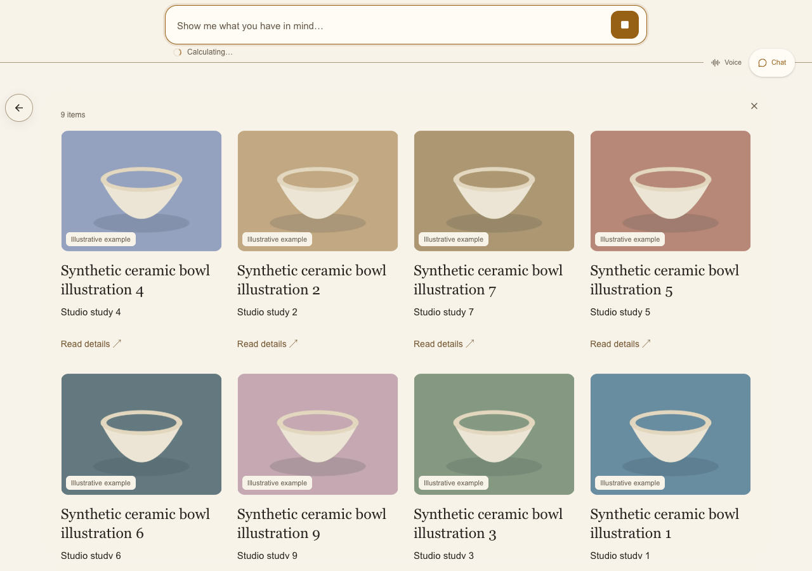

# Complex request speed and activity UI — September 26, 2026

The four follow-up speed changes are implemented locally, followed by the requested compact activity UI. Live Brave chat displayed model-backed results in **4.872–7.613 seconds** after submission; the later checks after the guidance adjustment ranged from **4.872–5.885 seconds**. A confirmed filter needed one model round, and reopening the retained estimate after Home took **2.938 seconds**. Complex final answers still took up to **11.799 seconds**: the latency target remains partial.

## Shared implementation

1. **Overlap independent preparation and remove redundant persistence.** Mailbox creation and task preparation run concurrently, with cleanup if either fails. Catalog/media loading overlaps the read-only access check. Read-only refresh does not write or advance the session revision. Built-in query changes reuse validated state and retain the final version check; other capabilities keep their reservation path. Independent final checks also overlap.
2. **Restore retained state with fewer requests.** Home/history restoration first uses the current generation and saved bookmark. Only the specific pre-write stale-generation rejection permits one refresh and one restore retry. Manual changes, cancellation and publication validation still reject obsolete work; this is not a paid model retry.
3. **Skip prose-only model rounds when appropriate.** Shared task guidance asks the model to combine requested scope, filters and sorting in one query patch. An optional `completion: "display_only"` hint can end a sole display request after a complete result and its exact browser receipt. The server additionally checks request eligibility, result coverage, focus and clarification state. Calculations, comparisons, research and substantive questions continue. The confirmation contains only the verified matching count.
4. **Keep useful intermediate results visible.** A compound task can display its filtered selection, continue calculating, then finish the answer. Results and calculations remain validated; partial generated prose does not become a committed answer or history entry. Cancellation retains confirmed results.

These are shared platform changes. No restaurant names, prices, item IDs, local tax rates or publisher-specific branches were added. The model and reasoning settings were not downgraded. Publication authorization, strict schemas, optimistic concurrency and browser display receipts remain required.

## Live chat evidence

Application: local FlowPath Studio, Brave, `/s/cuts-slicescuts-and-slices-qa`. Recording: `c7e167c3-fd68-4828-b46e-97a33c2c37c5` (raw transcript and model payloads remain local and ignored by Git).

Timing starts at `chat.requested`, before preparation/restoration, and ends at the first useful `visual_result: observed` diagnostic. Final state uses `surface.request.committed`. Previous content and loaders do not count as a result. Direct operations use their correlated display traces within the request window.

| Request | First useful display | Committed answer | Model calls |
| --- | ---: | ---: | ---: |
| Complete published menu | 3.756s | 4.057s | 0 |
| Vegan slices under $8, descending; initial attempt | 7.613s | 11.492s | 2 |
| Vegan slices under $7, ascending; explicit display completion | 4.972s | 6.006s | 1 |
| Vegan slices under $8, descending, plus one-of-each subtotal | 5.209s | 11.799s | 3 |
| Two Vegan Speciality slices and one Vegan Veggie slice | 5.885s | 9.189s | 2 |
| Same quantities as whole pies | 4.872s | 8.406s | 2 |
| Home | 1.902s | No answer commit | 0 |
| Bring back the current estimate | 2.938s | 3.401s | 0 |

The complete menu had 62 offerings. The $7 filter showed two $6.75 options. The $8 descending filter showed $7.50, $6.75, $6.75, and the requested one-of-each subtotal was **$21.00**. The editable slice estimate was **$21.75**; the whole-pie follow-up preserved quantities and produced **$149.15**, retained after Home. All are before-tax estimates; no checkout, payment or researched-tax verification occurred.

The initial model omitted the optional completion hint. Strengthening its guidance led the next simple filter to use one round; the compound calculation correctly continued. The final guidance was subsequently shortened to pass existing dense-context limits. That last wording compaction passed offline checks but was not live-retested.

The preceding pass measured a compound filter at 6.903s first display / 11.240s committed, and estimate recall at 4.938s / 5.756s; see the [earlier report](qa-speed-2026-09-26.md). These observations differ in wording, state, cache warmth and intermediate build. They are not controlled A/B results, averages or production percentiles. The complete-menu measurement in this pass was slower than the earlier 2.347s result. Do not generalize the fastest sample into a latency guarantee.

Trace IDs, in table order: `dc6c0d53-a563-41e7-9fa6-1c173869d021`, `f024c3c2-5aee-4137-bde4-06b281ac01eb`, `dc5209bf-8119-4792-ab40-4c4f3254861f`, `2952c7a8-2290-4cb0-953e-2a844d8fa27b`, `f3ff5834-31e5-47e7-87d5-2ab34378bcec`, `0ac15c76-e343-4aba-824e-34816b3ffda3`, `c5321a1b-5cea-405d-892b-0cdd14ef73bc`, `44d4ecea-1fda-44bd-9cfe-efc2ea50a0ae`.

## Activity UI added after the speed work

- A small indeterminate orbit and gently fading label share the publisher's colors in chat and voice. Reduced motion disables rotation and movement.
- Labels follow actual task events: checking details, organizing results, searching the web, calculating, showing results and finishing the answer. No artificial percentage, staged timer sequence or extra model call.
- Chat reserves one compact status row below the input. It stays clear of the divider and Voice/Chat controls, with no layout shift as labels change. Existing results remain visible. Voice uses the existing lower waveform status area.
- Duplicate conversation-loading text was removed from the result grid. Manual grid updates retain their separate status. A generic slow-request timer no longer overwrites a more specific event label.
- Status is announced politely; the existing Stop/Cancel controls remain usable. Failure, cancellation and completion clear the activity indicator.

These screenshots use synthetic ceramic products and mocked provider events, not the live restaurant session:

[Mobile activity UI](screenshots/qa-speed-2026-09-26/activity-mobile.png)

## Verification and limits

- Final focused server/unit run: **92 passed**, including display-only completion across product/service fixtures and chat/voice channels, continuation for compound questions, exact display acknowledgment, stale writes, read-only refresh, task connection and dense context limits. The added guidance initially exceeded the unchanged 48,000-byte ceiling in two dense fixtures; concise wording restored passing results without raising the ceiling. The provider connection mock now reads the actual cached developer-input format.
- **17 focused browser scenarios passed** in isolated groups: eight speed/activity, seven retained-view and two voice progress. Providers/microphone are mocked; query execution, saved-view restoration and receipts use the local demo server. Checks cover stale events, cancellation, desktop/mobile layout, reduced motion and retained results.
- Full ESLint and production build, including TypeScript, passed. Diff checks passed. This is not a claim that the complete repository test suite passed.
- Live evidence is one publisher in Brave chat. Real voice speech, startup, interruption, another live publisher, a physical mobile device and production remain unverified. The last UI changes were browser-tested with mocked events rather than consuming further live calls.

## Cost and handoff

Five paid chat submissions produced **10 measured provider calls**, costing **$0.370005**, with no pending reservations. Cumulative conservative usage is **$6.297494 of the approved additional $10**. This is the local QA ledger, not an invoice. The test site's existing 50-message daily chat allowance is exhausted and was not increased.

The recording is stopped. Its active recorder-specific budget config is archived to avoid blocking later manual testing with a stale recorder ID. Project development/test servers are stopped after verification. Changes remain local on `codex/recorded-menu-photo-recovery`; this round does not commit, push or deploy Studio.

Next: profile remaining preparation/display persistence across cold and warm requests, measure a second publisher, then record actual voice interruption and retained-research/tax continuation. Preserve semantic completion and exact display proof while reducing latency; do not trade them for a faster but incomplete answer.
