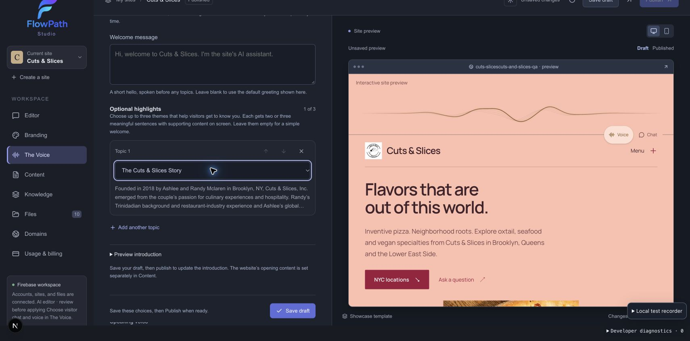
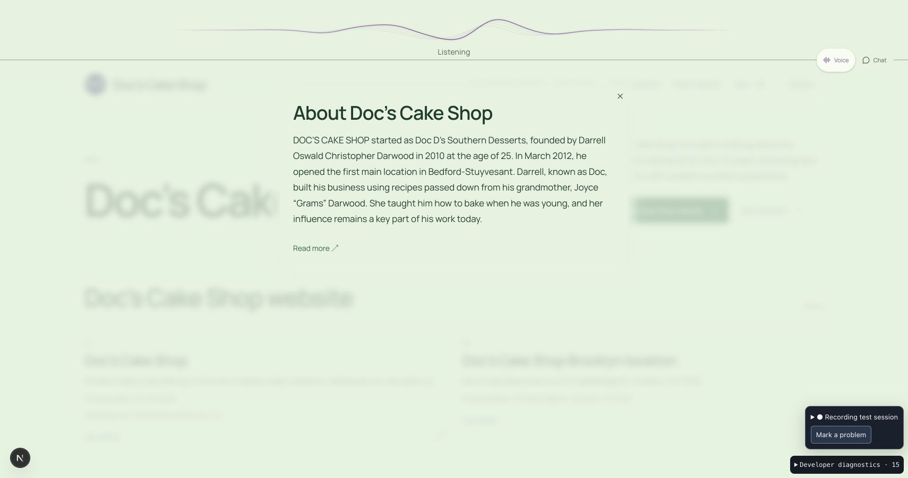

# Conversation opening QA — September 28, 2026

## Scope and implementation

The publisher chooses who speaks first, supplies optional welcome words, and may select zero to three introduction themes. The continuing assistant role remains separate. Changes are in shared platform code; no publisher ID, business name, menu item or location routes behavior. The work preserves the existing dirty checkout and does not deploy or publish changes to either real test site.

The user's live correction was accurate: a list of more than 300 records/facts was unsuitable for an introduction, and the initial narration described headings instead of explaining their subject.

- Studio now offers at most six editorial themes, with practical overview/hours/contact fallbacks bringing the total to no more than eight. Individual products, service records, raw fact fields and administrative pages are not suggested as introduction themes. Existing saved selections remain resolvable rather than being silently replaced.
- Actual short source sections and qualified facts feed Studio, voice and the information surface. The preview identifies source material, not a promise of exact model wording. Welcome text is always separate and comes before selected topics.
- Fresh assistant-first Live sessions reserve the ordered selected passages and narration policy in startup context. Coverage explicitly identifies any omitted topic. Whole passages retain their qualifications; incomplete coverage uses the complete commentary fallback. The opening is an exception to ordinary terse-answer preferences, asking for two or three meaningful sentences when the source supports them, rather than reading page headings.
- Browser readiness still gates speech. A short welcome and explicit begin instruction start the prepared introduction; visitor-first and resumed sessions remain quiet. Complete priming avoids resending all source text and the long narration policy.
- The same information surface, Motion transitions, published-reference validation and Back/Forward history present each topic. Recognized speech and manual interaction cancel the introduction; microphone volume alone does not. The observer retains a bounded 120-second guard, with a 1.5-second grace period between topics.
- Caption evidence is consumed as each topic advances, so a founder's name mentioned in the story cannot prematurely open a later founder card. Published person/profile records accept unambiguous first- or last-name cues; other items do not get fuzzy name matching.

## Real Brave inspection and live evidence

Only the authorized local Studio/visitor host was used. Real customer drafts were not saved or republished.

- **Cuts & Slices:** the actual topic picker now has six themes: story, planning a visit, choosing a cut, community, founder and business overview. Its story preview contains the substantive published paragraphs, including the founders and culinary background. The earlier hundreds of individual records/facts are gone from this picker. No configured opening topics were changed or published.
- **Doc's Cake Shop:** six useful choices are available, including Our story, the dessert menu, location, founder, catering and hours. The three existing published selections are preserved. The story preview includes the founding, family recipes and first location rather than only the About heading.

Recordings are local and opt-in; they contain provider text transcripts, inputs, events and confirmed display states, not an audio recording or hidden reasoning. Do not reproduce incidental visitor speech from the mobile check.

| Recording | Result |
| --- | --- |
| `526cb1f6-b371-4376-b7a8-a15c73f3da78` | Early tests found ambient microphone activity cancelling visuals. After that fix, three cards displayed, but spoken wording still described headings. This was not accepted as the requested semantic introduction. |
| `5867a735-ae86-4a96-b301-1ff63269b6bb` | Mobile viewport test was interrupted by actual recognized speech. The introduction yielded; it was not a completed mobile greeting or a physical iPhone test. One delegation began before cancellation; its final usage was not returned, so a conservative reserve remains. |
| `c8250476-1523-4bcd-a104-2c2fb3c38ea8` | Complete priming alone produced silence. Fixed by restoring the short spoken welcome and explicitly requesting the opening after readiness. |
| `fc6633e7-5349-4bd1-a394-4b7f3587058f` | Real Live narration explained the shop's founding and family recipes; all three selected topic states were acknowledged. Some founder/history repetition and an ambiguous combined date prompted tighter narration guidance. |
| `83e645d0-aaba-4d73-84f1-88b71e769b94` | Real Live narration retained the 2010 founding and March 2012 opening as separate events, described the grandmother's baking tradition, gave the address and invited questions. All three states were acknowledged. Cumulative caption evidence advanced the third card too early; follow-up verification is recorded below. |
| `f2a08eb7-a1cb-4672-a73e-c42fb406a143` | Real Live narration explained the story and family recipes. Consumed caption evidence prevented the premature founder card; only two states appeared because the model later said “Darrell” instead of his full name. The follow-up supports unambiguous published person names. Replaying this exact captured caption stream offline now advances story → location → founder at 21.016, 31.750 and 38.771 seconds after start. The last fix was replay-tested, not another paid live session. |

Two consecutive runs' first transcript events arrived **10.341 seconds** and **5.211 seconds** after the browser start action. The latter had publication-verified voice readiness at approximately **1.525 seconds** after server session preparation began. The final live run produced its first transcript at **5.515 seconds** and browser first-audio event at **5.739 seconds**. These are observations, not an isolated performance benchmark or a guarantee of audible timing. Removing repeated post-connect narration policy is the intentional change; provider and local timing can vary.

The [caption replay evidence](qa-greeting-caption-replay-2026-09-28.json) records all three transitions. It reuses the actual published opening passages and captured provider captions with output-delta activity; it does not simulate exact speaker playback gaps or perform a new browser rendering.

The published selection still overlaps: the shop's story and its founder repeat some of the same facts. The new picker makes distinct themes easier to choose, but the work does not silently rewrite that publisher choice. Exact phrasing and cadence remain model-dependent. Caption-based display following is approximate and is not word-aligned playback.

## Verification

- 189 focused unit/server tests passed for greeting content, curated themes, record resolution/API authorization, observer behavior, startup priming, session/control and workspace authority.
- Scoped ESLint passed.
- Final isolated browser pass: 14 cases passed across Studio setup, zero-to-three topics, canonical-record and legacy entity/fact presentation, history, interruption, desktop, mobile and reduced motion. Provider speech was mocked in those cases; real Live evidence is listed separately above.
- Production build and TypeScript verification passed.
- Physical iPhone playback, interruption and microphone behavior remain unverified. Desktop Brave with a mobile viewport is not a physical-device test.

This screenshot shows an unsaved preview selection used for inspection, which was discarded afterward.

## Budget and closeout

The user's fresh allowance was **$5** for this local greeting task. Seven intentionally bounded voice sessions totalled approximately **468.4 seconds**, measured from browser start through stop (including connection time). No intentional text-model QA requests were submitted. A possible interrupted delegation during the mobile run lacks final usage; it must not be counted as free. The remaining guard was reduced to $3.50 rather than resetting the daily allowance between recordings. Exact provider billing has not been reconciled with an invoice.

All six listed recorders and all seven voice sessions were explicitly stopped after observation. The development server and isolated browser-test server are stopped; no listener remains on ports 3220 or 3225. The temporary mobile viewport was reset. The completed local QA guard was archived so its stopped recorder ID does not block the user's next manual test. Recordings and evidence remain local. No deployment, commit, push or real test-site draft/publication change was performed.

## Technical references

The startup-context and explicit-greeting changes follow the provider's [Live session context delivery and greeting guidance](https://developers.openai.com/api/docs/guides/live-conversations). Runtime and local recordings, rather than accepted instruction acknowledgments alone, are the evidence for spoken behavior.
