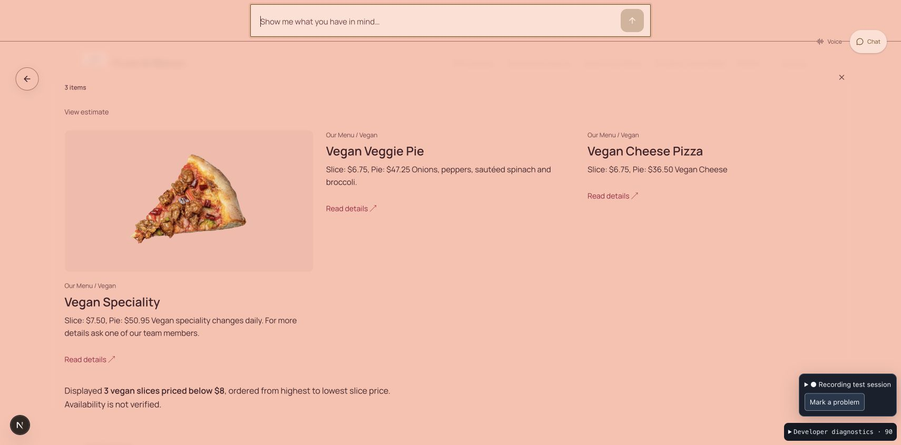

# Visitor response speed — September 26, 2026

Follow-up: [complex-request improvements, activity UI and updated cost](qa-complex-speed-2026-09-26.md). The measurements below describe the preceding pass.

The latest local Brave chat checks display the complete menu in **2.347 seconds**, all published photos in **2.624 seconds**, and a compound category/price/sort result in **6.903 seconds**. These are Enter-to-first-useful-display measurements, not the time to show a loader. Model-backed tasks still take several seconds and the final explanatory reply can arrive later. The latency goal is **partial**, not complete.

## Scope and measurement

- Application: local FlowPath Studio, `/s/cuts-slicescuts-and-slices-qa`, using the actual configured API and Firestore backend in Brave. No microphone connection or audible voice test was started in this pass.
- Latest recording: `ac53d513-6fa7-47eb-b715-d827245c0b58`. Earlier comparison recording: `62461146-0177-405b-8d3c-990e8e97e1f2`. Raw recordings remain local and ignored by Git.
- Start: browser `chat.requested`, captured on submission **before** workspace restoration. First useful result: browser `diagnostic` with `visual_result: observed`. Final state: `surface.request.committed`, which includes later response/history completion.
- Direct commands have a separate display-operation trace. Their visual result is correlated within the single request's start/commit window, after the surface changes to that request. A loader, stale previous view, or model's claim of completion is not counted.
- These are individual successful development-server observations, not a controlled A/B benchmark, cold-start measurement, average, or production percentile. Context, wording, cache warmth, and intermediate builds differed. The final filter used a warm prompt prefix.
- **Timing correction:** estimate recall after Home took **4.938 seconds**, including 1.988 seconds restoring the workspace. The previously reported 2.95 seconds measured only the subsequent display phase. Always include this preparation in future comparisons.

| Real chat task | Earlier first useful display | Latest first useful display | Latest committed answer | Latest model rounds |
| --- | ---: | ---: | ---: | ---: |
| Complete published menu | 13.327s | **2.347s** | 2.955s | 0 |
| All published photos | 5.216s | **2.624s** | 3.234s | 0 |
| Recall current estimate after Home | 19.467s | **4.938s** | 5.756s | 0 |
| Vegan slices below $8, highest price first | 12.285s | **6.903s** | 11.240s | 2 |

The menu comparison uses the early and final attempts in the latest recording; the other earlier observations come from the earlier recording. Estimate recall was measured before the final conditional-write optimization and was not rerun afterward. Another successful compound filter in this pass took 9.572 seconds; the 6.903-second result is not a guarantee for every request.

Trace references:

| Task | Earlier request trace | Latest request trace |
| --- | --- | --- |
| Menu | `d5e127a7-feb7-4635-afb7-4874b2024a60` | `e1f9956a-983f-4941-82eb-c00619fd8bef` |
| Photos | `9dc3f4e7-e3b0-4210-8772-b4e4081906dd` | `418e6c60-4e43-46cd-8f5a-dc13191f0564` |
| Estimate recall | `a39337ac-8f6b-4869-939f-7c3a95fd05d4` | `b2888fbf-a114-43e9-8366-4892fdea2976` |
| Compound filter | `383582ef-3dd8-43e6-8482-05225fd91d84` | `dc8fd545-b7e3-4ddc-8ed4-d5c56e534ea6` |

## What changed and why

1. **Fewer preparation round trips.** A shared command request now performs generation checking, cancellation and command preparation together. Model-only questions skip the command endpoint. Settling an already prepared workspace no longer immediately refreshes it again. Manual changes still cancel stale work, and restored history still requires current server state.
2. **Direct handling for unambiguous existing operations.** Complete-menu requests use offering collections within the publication's menu hierarchy. Exact requests to reopen the current estimate use `estimate.show`. Compound price/category/sort requests, estimate edits, research and questions still use the model. No restaurant names, item IDs, prices or tax rates were embedded in routing.
3. **A reusable model prefix.** Stable capability schemas and policy precede current state, enabling explicit prompt caching on the supported GPT-5.6 path. The most recent request is also supplied after historical context, fixing a live regression where an earlier $7/ascending query displaced the new $8/descending instruction. Recorded cache hits reached 12,560–12,621 input tokens; current state and results remain fresh. See [OpenAI prompt caching](https://developers.openai.com/api/docs/guides/prompt-caching).
4. **No avoidable price-schema correction round.** The model supplies the field, amount and currency. The server binds an omitted money basis from that exact published field. The model-facing schema prohibits inventing a basis/unit. Explicitly conflicting units or currency remain errors rather than being silently changed.
5. **Less repeated persistence.** One-use snapshots avoid immediately rereading state the same operation just prepared. Pure built-in query edits validate and save their operation/result atomically. Other adapters retain reservation before execution. Usage events are persisted in a single batch.
6. **Conditional session writes.** Visitor sessions can reuse Firestore's exact update-time token for a conditional write, avoiding a transaction reread. Tokens contain no cached visitor content, are bounded to 32 entries per store, and are scoped by document key. Missing tokens fall back to the existing transaction. Concurrent edits, deletion and replacement reject the write; failed writes do not trigger paid retries. Other storage namespaces retain their previous behavior. See the [Firestore document update precondition](https://docs.cloud.google.com/nodejs/docs/reference/firestore/latest/firestore/documentreference).

The changes are in shared chat/voice task, query and persistence code. Current-publication authorization, cancellation, schema validation and exact browser display receipts remain required. A faster write is not permission to overwrite newer state or claim that content is visible early. No model downgrade, production configuration change, dependency upgrade, or automatic paid retry was added.

## Real behavior checked

- The complete-menu command displayed **62 published offerings** and cleared the previous subset without a model call.
- The all-photos command displayed **10 published assets** without a model call.
- The final compound filter displayed three matching items, correctly ordered: $7.50, $6.75, $6.75. Changing to below $7 displayed the two $6.75 items.
- Two cheese slices and one veggie slice produced the published **$20.25 subtotal**; changing the same quantities to whole pies produced **$120.25**. This pass deliberately used published subtotals and did not validate researched tax.
- Home followed by estimate recall restored the current estimate without regenerating it or replaying prior quantity edits.
- Live iteration caught stale-history criteria and unnecessary price-basis correction rounds. Both were fixed and retested; unsuccessful intermediate trials are included in the cost ledger.

[Actual all-photo display](screenshots/qa-speed-2026-09-26/gallery-desktop.png)

## Verification

- **156 focused unit/server checks passed**, including query routing, model binding, shared chat/voice task execution, cancellation, context size, usage batching, capability transactions and Firestore version conflicts.
- **13 distinct mocked browser scenarios passed:** seven retained-view cases and six speed cases. The first combined run passed 12 and hit the isolated fixture's 12-site creation cap before the last test could run. All six speed cases then passed in fresh test data, including that last mobile viewport/display-receipt case. This is not a claim that the complete repository browser suite passed.
- TypeScript, full ESLint, production build and `git diff --check` passed.
- Product/service fixtures exercise the shared path. Only Cuts & Slices received live model tests in this pass; a second publisher, real mobile device, audible voice startup/interruption and production behavior remain unverified.

## Remaining work

1. Reduce the remaining preparation/display persistence on model-backed tasks. The final 6.903-second filter still spent about 2.28 seconds in server preparation, 2.43 seconds in the first model response, and 2.18 seconds from that response to the first useful display.
2. Eliminate an unnecessary final prose round where the confirmed result fully satisfies a request, while preserving semantic completion checks and truthful voice delivery. In the final filter, useful items appeared at 6.903 seconds but the answer state finished at 11.240 seconds.
3. Safely consolidate Home/history restoration. It can add roughly two seconds before submission reaches the normal task path; do not simply bypass restoration or reuse an unvalidated old query.
4. Measure cold and repeated requests across another publisher and then record actual voice startup, interruption and end-of-speech-to-display. Current chat gains must not be described as verified microphone gains.
5. Follow up separately on the visual imbalance when only some result items have photos. Speed changes preserve the existing shared presentation; this pass is not a new layout redesign.

## Cost and handoff

The latest recording has **31 measured provider calls**, no pending reservations, and a conservative charge of **$1.255643**. Added to the earlier **$4.671846**, cumulative usage is **$5.927489 of the authorized additional $10**. This is the local QA ledger, not an invoice or a new spend authorization. The most recent response reported five daily chat messages remaining for the test site.

The recorder is stopped, and the recording files and charge ledgers are retained. This pass's active recorder-specific budget configuration was archived after shutdown so a stale recording requirement cannot block the user's next manual test. The development and isolated browser-test servers are stopped; neither port 3220 nor 3225 has a listener. Implementation remains local on `codex/recorded-menu-photo-recovery`; this pass does not commit, push or deploy the Studio changes.
