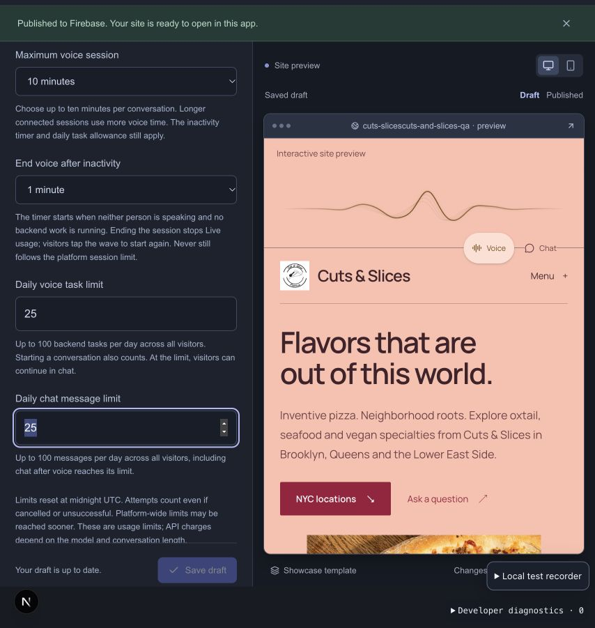
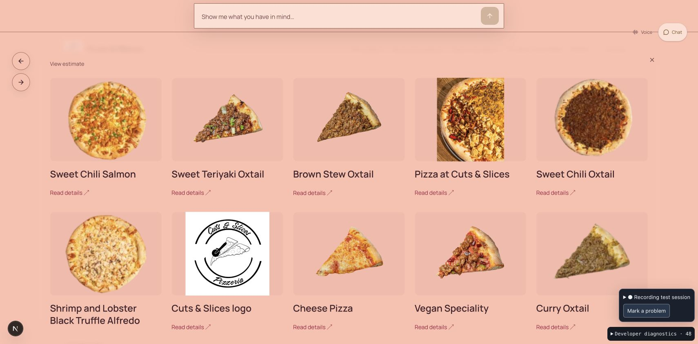
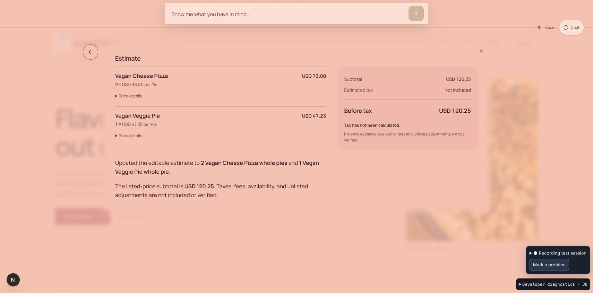

# Recorded voice timing and test limits — September 26, 2026

Recording `ae3fd28f-f4bb-485d-9bdc-2cbd9e9622c7` was analyzed locally. It contains 1,939 events from 12:40:10.888 to 12:43:03.636 EDT. It attaches to an already-running voice connection: earlier speech and the complete browser-to-provider startup are unavailable. No new paid provider requests were made during the initial repair below. The subsequent authorized live chat pass and its measured limitations are documented at the end of this report.

## What happened

| Request | Recorded outcome | Observed timing |
| --- | --- | --- |
| Two Oxtail slices and one Cheese slice, including researched pickup tax | Correct subtotal $28.50, estimated tax $2.53 and total $31.03. Initial speech predates recording; later processing is captured. | First visual at 16.8 seconds, taxed visual at 23.7 seconds, useful result audio at 30.4 seconds from the recorded turn timing origin. |
| Make Oxtail three slices; keep Cheese | Correct subtotal $41.00, estimated tax $3.64 and total $44.64. No second web search. | First visual at 13.3 seconds and useful result audio at 20.1 seconds. |
| Convert those quantities to whole pies | Correct three Oxtail pies plus one Cheese pie and $250.50 subtotal were displayed. Retained tax research was recalled, but the connection's two-minute timer cancelled work before final tax completion. | First visual at 15.7 seconds. Session stop occurred 121.2 seconds after activation, during the fourth model round. The later $272.73 total verified in earlier typed QA was **not** completed in this voice recording. |
| Show the complete menu in chat | Three identical submissions raced after pending view restoration. Two were aborted; the surviving request displayed all 62 published offering records. | 14.2 seconds from actual chat submission to first visible result; approximately 19.7 seconds to final response. This excludes time spent attempting the preceding restoration. |

The five-task daily voice allowance also reached zero. Starting a voice connection consumes one task in addition to delegated backend tasks. This was a separate limit from session duration.

Several interrupt/restore requests overlapped after voice ended and returned state-conflict responses. The three identical chat submissions were confirmed by distinct request IDs in the same timestamp. The fix below prevents repeated identical submissions from entering asynchronous restoration simultaneously; it does not remove stale-state validation or claim that every possible history race has been eliminated.

Model rounds generally took about 1.2–3 seconds each. The quantity edit unnecessarily read the current estimate before updating it. The variant edit looked up published price fields, updated the basket, recalled previously retained research, and began another round before the timer stopped it. Repeated serial publication/session reads added delay around those rounds. Recorded display settling was usually 0.37–0.73 seconds; the larger delays were not primarily animation duration.

## Shared platform repairs

1. **Configurable ten-minute sessions.** Studio offers five- and ten-minute choices. Both server and browser accept the selected duration, bounded at ten minutes. Existing publishers without a setting keep the two-minute default. Idle disconnection, daily allowances and paid-work limits remain independent.
2. **Relevant facts available before choosing tools.** Every task round receives the current server-owned estimate revision, quantities, bounded published price options for basket records, and exact retained cited tax excerpts. Models can use that context directly instead of making redundant `estimate.read`, `records.lookup` or `research.recall` calls. A variant change still requires a new applicability decision; stale/foreign evidence is excluded. Prior research survives a variant change even when none of the old line classifications apply. No tax rate or restaurant-specific rule is hardcoded.
3. **Fewer sequential storage reads.** Publication and session reads overlap where independent. A just-reserved model round supplies its snapshot to instruction preparation once, avoiding an immediate duplicate read pair. Tool execution, manual cancellation, optimistic revisions and exact display receipts still check current state. This is not a shared stale cache.
4. **Duplicate chat prevention.** Identical submissions claim a pending request before the first asynchronous surface transition. A different request may still interrupt; cancellation and errors release the pending claim.
5. **Better timing evidence.** The recorder now distinguishes model reservation, context preparation and image preparation from provider time. Voice retains only numeric startup milestones (mailbox, provider response, publication verification, sideband readiness and browser readiness). Starting recording later can capture those numeric server milestones without recovering or buffering unrecorded speech, prompts or provider events. Full browser activation/preflight timing still requires recording before tapping the wave.

Context additions are bounded and explicitly marked when omitted under the unchanged instruction ceiling. Existing retrieval tools remain available. No extra tool rounds, automatic paid retries, model substitutions or provider-token limits were introduced.

## Applied test-site settings

Cuts & Slices `/s/cuts-slicescuts-and-slices-qa` was saved and published with `visitor.voiceSessionSeconds = 600` and `visitor.voiceDailyLimit = 25`, as explicitly approved. A narrowly authorized draft/publication comparison showed only those two changed paths before publishing. Studio confirmed publication. The existing one-minute inactivity setting and 25-message chat allowance were preserved. Today's used tasks were not reset; 25 is the daily total, not 25 additional tasks.

## Verification and remaining work

- All 75 focused server tests passed: default/selected/max duration, cleanup, recording attachment, unchanged provider behavior with recording on/off, current estimate context, retained citation scope and expiry, variant tax incompleteness, one-use model snapshots and stale-generation cancellation, task binding, context ceilings and provider-connection failure recovery.
- The production build (including TypeScript) and scoped ESLint passed.
- Three isolated browser tests passed with synthetic data and mocked providers: duplicate submission plus a distinct interruption; provisional versus committed responses; cancellation and error cleanup. Their obsolete carousel selectors were updated to the current information article. Other legacy carousel tests were not included in this targeted run.
- These are code and mocked-browser results, **not a measured live speedup**. The older startup optimizations already overlap preparation/offer creation and reuse in-flight preparation; they were preserved rather than reimplemented.
- Next live check: reload the published page, start the recorder **before** connecting voice, repeat the first three estimate requests, then make one removal edit and open the complete menu. Measure startup, time to first useful display, final audio, redundant tool calls and history behavior. Stop if unexpected paid retries appear. Actual speech/interruption, provider latency and another publisher's live behavior remain unverified by this pass.

The development server on port 3220 was left available for the user's next manual test. The isolated regression server on port 3225 stops when its test run finishes. No source commit, push or production deployment was performed in this repair.

## Follow-up: live chat performance and catalog correctness

Recording `62461146-0177-405b-8d3c-990e8e97e1f2` captures the follow-up in Brave on local `/s/cuts-slicescuts-and-slices-qa`. It includes failures, repairs and successful retests, rather than only successful requests. The user separately approved raising this test site's **daily chat total to 50**; that setting was saved and published through Studio. Ten-minute voice sessions, 25 daily voice tasks and existing used counts were preserved. This is the only publisher-specific change in this pass.

### Shared repairs found by real requests

- **Complete criteria reach the model.** The fast command parser previously recognized a category or sort phrase and then treated the remaining price/unit constraint as literal search text. It now handles only complete supported commands; compound or unparsed predicates reach the model intact. Product and service fixtures cover the same behavior.
- **Model schema matches runtime measurement rules.** Money comparisons require currency and use a published price `basis`; they cannot carry a numeric measurement `unit`. The exported expression schema now describes rules previously present only in runtime refinement. The successful retest required no malformed-money correction round. Invalid data still fails validation.
- **Query identity is owned by the server.** A real refinement failed because the model mistyped an opaque query ID. Model `query.patch` proposals now send operations; the bridge binds the exact query ID and revision supplied to that model round. It never silently switches to a newer query. Stale generations/revisions still reject mutations; explicitly invalid IDs return bounded correction feedback.
- **Nested galleries select each scope once.** The all-photo command no longer combines a parent library and its child album as incompatible union members. It includes the parent scope once, preserving descendant records and clearing unrelated offering filters when the visitor explicitly requests all photos.
- **Less repeated preparation and context.** Removed duplicate knowledge policy and repeated directory/reference data while preserving names, aliases, provenance and retrieval for omitted facts. Publication/session reads overlap where independent; completed-model usage is persisted with the next required reservation or task completion instead of a separate write each time. Cancellation/failure flushes remain covered. Chat command fallback avoids a second interrupt, and current-publication checks no longer reload unrelated usage data on every operation.
- **Visible feedback and layout.** Existing provisional answers, truthful progress and exact display receipts remain. Guidance requests a short acknowledgment after a confirmed grid or estimate instead of restating the display. Some estimate replies still repeat totals/caveats, so this remains partial. The gallery's unstyled “View estimate” control now uses the information surface's typography, colors and accessible target size.
- **Timing starts at Enter.** New `chat.requested`, preparation-stage and numeric `model.payload` events separate browser preparation, server reads, prompt size, provider time and display acknowledgment. Recording on/off does not change provider prompts or actions. No hidden reasoning or audio was added to recording.

### Observed live outcomes and timings

The following final-chain timings start at the actual typed submission, include application preparation, and are individual observations rather than an A/B benchmark. “First display” is the confirmed useful visual; final response can follow later.

| Check | Outcome | First display / final reply |
| --- | --- | --- |
| Vegan choices under $8 per slice, descending | Three correctly priced choices; the compound criteria were retained after the parser fix. | Earlier repaired run: approximately 10 seconds / 14 seconds. |
| Narrow to under $7 per slice, ascending | Two $6.75 choices; one valid query mutation, no ID or money-schema retry. | 9.50s / 14.42s |
| Vegan slices under $6 | Zero matches, with the requested constraint retained. | 8.49s / 11.98s |
| Remove price limit, keep vegan | All four vegan offerings, retaining the published availability qualification. No model call. | 3.28s / local completion |
| Two Vegan Cheese slices and one Vegan Veggie slice | Published subtotal **$20.25**. One estimate update, no redundant estimate read. | 10.17s / 14.76s |
| Same quantities as whole pies | Two at $36.50 and one at $47.25; subtotal **$120.25**. No redundant price lookup. | 8.95s / 13.13s |
| Back, then Forward | Restored the $20.25 historical slice state and then the $120.25 pie state. | Manual control checks; no paid model call. |
| Home, then recall estimate | Restored the same $120.25 pie estimate. A 12.42s provider round was the largest delay. | 19.47s / 24.59s |
| All photos, open one, Back | Ten published images in a wide grid; detail opened and Back restored the grid. No model call. | All-photo display: 5.22s |

Earlier in the same pass, full-menu browsing displayed 62 published offerings, comparison preserved slice/whole-pie price bases, and quantity/removal changes preserved the appropriate remaining items. No checkout, payment, inventory or real order was performed. Tax research was not repeated in this follow-up pass.

### Verification, budget and next work

- **159 focused server/unit checks passed**, covering query commands, shared product/service behavior, current query binding, stale-state rejection, context ceilings, usage flushes, recording behavior and task connection/control.
- **All five focused isolated browser regressions passed** with mocked providers: repeated versus distinct submits, one-interrupt model handoff, provisional/final answers, cancel/error cleanup, and initial gallery receipts plus viewport updates after scrolling at 393×852. Production build/TypeScript, scoped ESLint and diff checks passed.
- Real Brave checks were desktop. The browser viewport override did not change the live tab's dimensions; it was reset. The mobile claim is limited to the isolated browser regression, not a live phone or microphone test.
- **This pass: $1.188198 conservative API accounting. Additional $10 allowance used to date: $4.671846.** All 31 provider reservations settled with measured usage. These are conservative usage bounds, not an invoice. No new model/service tier or automatic paid retry was enabled. Existing bounded tool-correction rounds remain.
- Recording was stopped and the pass-specific active QA guard configuration was archived, retaining the ledger and logs. This prevents an expired recorder requirement from blocking the user's next manual test.
- **Performance remains incomplete.** Ordinary model-backed requests still need about 8–10 seconds for a useful display; the Home-recall outlier needed 19.5 seconds. The next scoped optimization is consolidating safe browser/session preparation into fewer round trips while preserving generation/CAS/receipt checks, then improving stable prompt-prefix reuse and measuring provider variance. Do not remove correctness checks or claim a speedup from incomparable prompts. See [OpenAI's latency guidance](https://developers.openai.com/api/docs/guides/latency-optimization) for the fewer-request, shorter-output and stable-prefix principles used in this review.
- Next acceptance: record before starting an actual voice session; verify startup, immediate interruption, the shared chained estimate/filter flow, retained tax applicability, and another publisher with services/different locations. Remaining duplicate estimate prose also needs review. No production deployment, source commit or push was performed.
- At the end of this follow-up pass, the verified FlowPath development process was stopped gracefully. Ports **3220 and 3225 have no listening process**. The earlier initial-repair note about leaving 3220 running no longer describes the final state.
