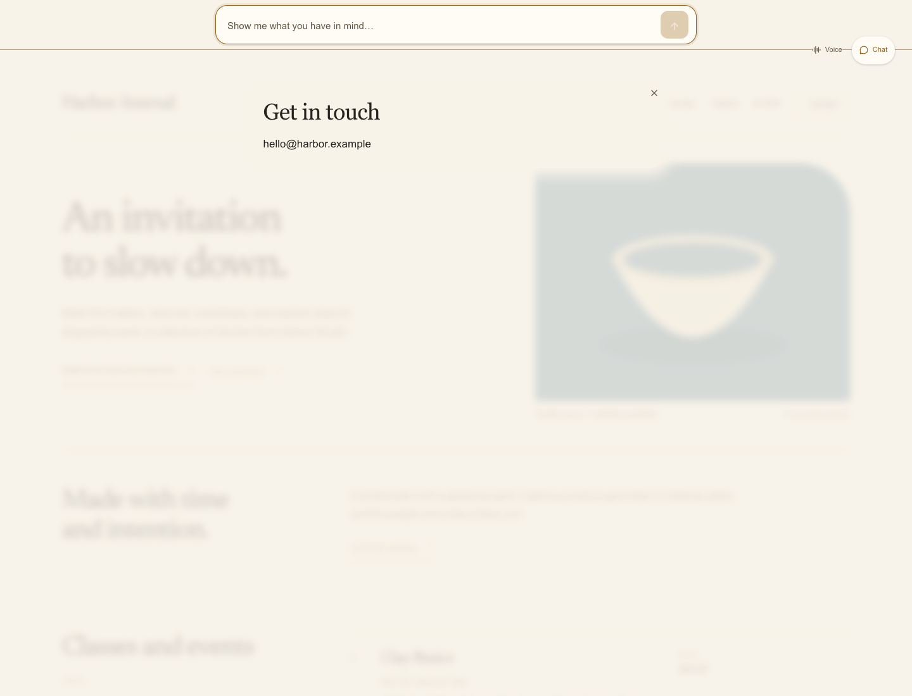
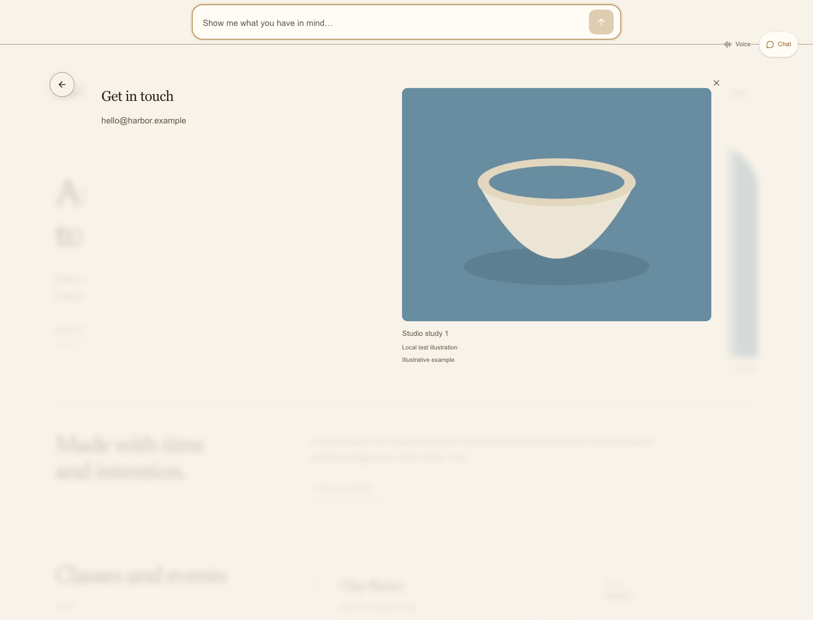
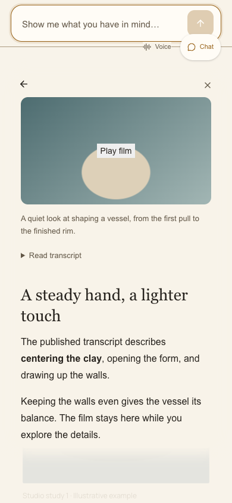

# Information surface: visual review

These are actual isolated Chromium captures from the synthetic acceptance scenarios. The ceramic artwork, published facts, player, research and maps are fixtures; they do not represent live provider or real business results. Website styling visible behind the card belongs to the separate website design work in this checkout.

## Soft perimeter: note 13, September 19, 2026

The outer border and dark drop shadow are replaced by a static, publisher-colored backdrop with feathered edges. Content has no filter, mask or opacity treatment. The transparent frame keeps its original geometry and allows complete focus outlines; surface controls now retain the palette's accessible focus color instead of inheriting the broader assistant's brand color.

The before images came from an unchanged production build of the current working checkout. The after images use the same synthetic composition and real Parchment/Midnight design tokens.

| Palette and viewport | Before | After |
| --- | --- | --- |
| Parchment, 1440px | [Bordered frame](perimeter-before-parchment-1440.png) | [Soft perimeter](perimeter-parchment-1440.png) |
| Midnight, 1440px | [Bordered frame](perimeter-before-midnight-1440.png) | [Soft perimeter](perimeter-midnight-1440.png) |
| Parchment, 390px | [Bordered frame](perimeter-before-parchment-390.png) | [Soft perimeter](perimeter-parchment-390.png) |
| Midnight, 390px | [Bordered frame](perimeter-before-midnight-390.png) | [Soft perimeter](perimeter-midnight-390.png) |

Also visually checked: complete [light](perimeter-parchment-390-focus.png) and [dark](perimeter-midnight-390-focus.png) Close focus rings, desktop focus, retained mock video with text on desktop/phone, and long reading at 320 × 600 with reduced motion in [light](perimeter-parchment-320-reduced.png) and [dark](perimeter-midnight-320-reduced.png). Back/Close keyboard order, hit targets, loaded images, native scrolling, and absence of horizontal overflow are asserted. The pre-existing behavior where long scrolled text can pass through the mobile control row remains unchanged.

Node 24.6.0 verification: lint, shared package/production build (including TypeScript), 12 information-surface unit tests, 24 shared rendering tests, and all 15 isolated `ai-carousel.spec.ts` scenarios passed. After the final focus-color correction, the production build, focused lint and both new palette scenarios passed again. The complete repository check and complete browser suite were not rerun for this appearance-only change. Voice, player and provider behavior was mocked; no live API or microphone was used. Physical devices, Safari/Firefox, actual media providers and assistive technology remain unverified.

The parent review flagged apparently missing desktop foreground content. Pixel inspection of the earlier saved PNGs and original-resolution review of the refreshed PNGs confirmed both heading text and bowl artwork; a dark/desktop rendering regression was not reproduced. Capture readiness now explicitly waits for decoded images and fully opaque, geometrically settled regions. Both palette scenarios passed twice, followed by a final two-scenario pass that also asserts heading ink and bowl pixels in the actual screenshots. Final test-source typecheck and focused lint passed. Use original-resolution image viewing if a preview appears blank.

Reproduce the browser checks after `npm run build` with `npm run test:browser -- tests/browser/ai-carousel.spec.ts`; append `--grep 'surface perimeter'` for only the two palette scenarios. The existing development server on port 3220 remains running; tests use a separate temporary demo server on port 3225.

## Initial and enriched states

| Composition | Desktop | Phone |
| --- | --- | --- |
| Published information, first answer | [Initial](desktop-initial-information.png) | [Initial](phone-initial-information.png) |
| Information with a newly primary photo | [Enriched](desktop-enriched-information.png) | [Enriched](phone-enriched-information.png) |
| Video, first answer | [Initial](desktop-initial-video.png) | [Initial](phone-initial-video.png) |
| Playing video with explanation | [Enriched](desktop-enriched-video.png) | [Enriched](phone-enriched-video.png) |
| Playing video, chart, retained explanation | [Chart](desktop-enriched-chart.png) | [Chart](phone-enriched-chart.png) |
| Research with attributed sources | [Research](desktop-research.png) | [Research](phone-research.png) |

Also reviewed: [short prose](desktop-initial-short.png), [comparison](desktop-comparison.png), and [long reading with larger text](phone-long-larger-type.png).

## Transition review

The browser records geometry on animation frames while a video gains an explanation, with intermediate captures [0](transition-0.png), [1](transition-1.png), [2](transition-2.png), [3](transition-3.png) and [raw samples](transition-frames.json). These captures inspect the actual transition, not separate staged end states.

The first review found an abrupt switch in the retained video's column width. The final composition animates the grid tracks together with the card width and measures real height. The new right region reveals at a readable destination width while the retained video resizes at its original aspect ratio. Text and video do not stretch. Resizing is included in settling, and final screenshots additionally wait for measured geometry.

The September 19 recording contains **83 animation-frame samples through 1,373ms**, with **30 distinct widths from 860px to 1,152px** in a 1,440px viewport. No sample has an empty surface, and maximum width is exactly the 80vw ceiling. Intermediate frames show the retained player moving left as the explanation appears on the right.

The browser acceptance scenario separately plays the mock video, adds an explanation and a chart, and goes Back twice. It checks one mounted player, no destruction, no extra seek, and uninterrupted playing state. Removing that video pauses/destroys it; restoring it retains the last position and requires explicit Play. Reverse restoration, reduced motion and keyboard focus are also exercised.

## Scope and limits

Review widths: 320, 390, 430, 768, 844, 1440, 1600 and 2560 CSS pixels; limited-height and landscape cases; 1.35× publisher text scaling; reduced motion; a simulated keyboard-sized visual viewport. The desktop card remains within 80vw and phone gutters remain 14px. The card has one reading scroll area, with local gallery/map controls.

On September 18, 2026, `npm run check` passed with Node 24.6.0: lint, typecheck, 559 server tests, 22 rendering tests, packed-consumer verification and production build. The focused isolated browser run passed all **17 scenarios** (12 surface, one template, four voice safeguards); the reproduction command is in the architecture guide. These results include the preserved concurrent website changes in the checkout.

The automated browser is isolated Chromium. Physical phones, a real operating-system keyboard, VoiceOver/TalkBack, live microphone audio, actual provider video settings, and live map tiles were not tested. Cross-origin map pan and provider-specific caption/volume settings cannot be promised after an iframe is removed. The mock proves player identity and orchestration, not provider playback quality. Native video restoration is implemented but hardware playback remains unverified.

For the architecture, limits, code map and a short manual walkthrough, see [the information-surface guide](../../information-surface.md).
