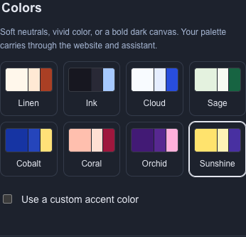

# Color palette refresh

Captured from the production build in isolated Chromium on 2026-09-16. The publisher, content and illustrations are synthetic. These are unedited screenshots of the actual website and Branding controls.

Four new palettes use visibly different page, section and accent colors:

| Palette | Direction | Desktop | Mobile |
| --- | --- | --- | --- |
| Cobalt | Royal blue and lemon | [Preview](cobalt-desktop.png) | [Preview](cobalt-mobile.png) |
| Coral | Salmon and raspberry | [Preview](coral-desktop.png) | [Preview](coral-mobile.png) |
| Orchid | Deep violet and pink | [Preview](orchid-desktop.png) | [Preview](orchid-mobile.png) |
| Sunshine | Golden yellow and purple | [Preview](sunshine-desktop.png) | [Preview](sunshine-mobile.png) |

The original four were also separated: Linen is warm cream/terracotta; Ink is cool charcoal/ice blue; Cloud is blue-white/ultramarine; Sage retains a fresh green direction. Saved sites keep their original palette definition until a publisher selects a refreshed swatch or resets styling and publishes.

[Desktop Branding with the live Cobalt draft preview](palettes-branding-desktop.png)

Visual review strengthened Coral's page background after the first capture looked too similar to Linen. The larger swatches show page, section and accent colors. Desktop captures use 1440 × 1100; website mobile captures use 390 × 844. The mobile chooser capture is the actual Colors fieldset.

Verification passed:

- `npm run check`: lint, typecheck, 537 server tests, 21 rendering tests, packed-package verification and production build.
- `npm run test:browser -- tests/browser/templates.spec.ts --output=test-results/platform/palette-refresh`: all nine scenarios. These include all three templates with menu, freelancer and guide fixtures, plus the new eight-palette chooser, four new palette save/reload cycles, desktop/mobile previews, publication isolation and matching assistant colors.
- Contrast tests cover main text, muted text and accents on page/section backgrounds, plus button text. Each pairing meets 4.5:1. Compatibility tests preserve saved colors during unrelated style edits and retain deliberately selected colors across template changes.

All testing used isolated synthetic data and mocked providers. The user's signed-in browser, saved site content and publication were not modified. No model calls, deployment or GitHub push were performed.

The schema, shared tokens and publisher steps are in the [implementation guide](../../templates-and-source-lifecycle.md).
