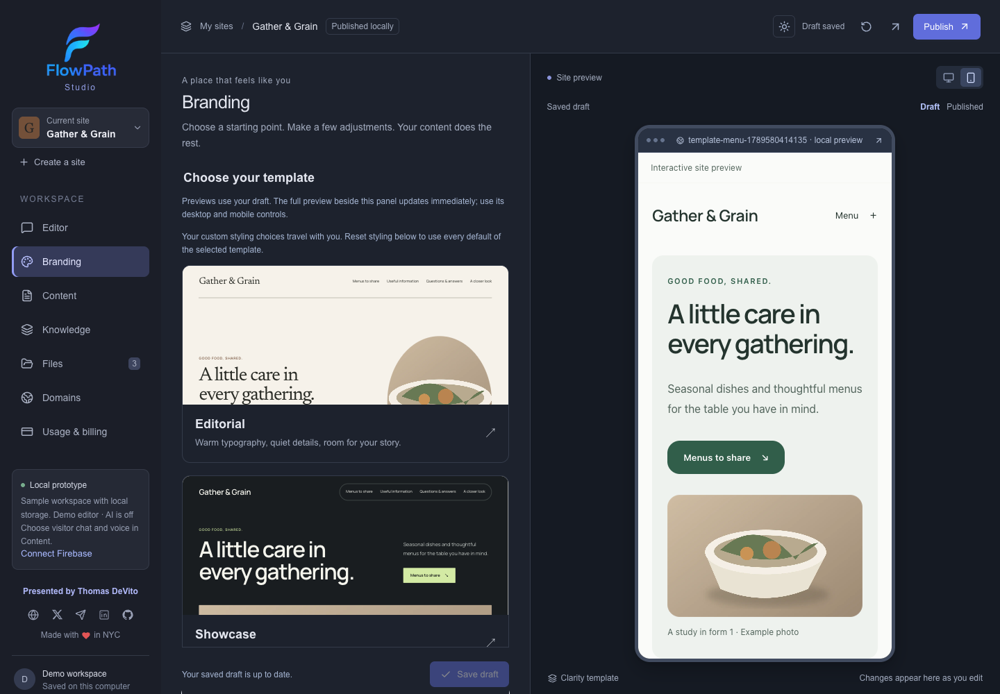

# Template visual evidence

These are the September 16 baseline captures. See the [September 18 website refinement](../website-design/README.md) for current desktop/mobile compositions, motion evidence and verification.

Captured from the production build in isolated Chromium on 2026-09-16. All business information, contacts, prices and illustrations are synthetic. These are unedited screenshots of actual rendered components, not design mockups. Full-page desktop captures use 1440 × 1000 viewports; mobile captures use 390 × 844. Studio frames exercise the embedded mobile layout on a desktop viewport. Sparse layouts also exercise 320px width.

## Nine content/template combinations

| Synthetic publisher | Template | Desktop | Mobile |
| --- | --- | --- | --- |
| Gather & Grain · menu/products | Editorial | [Full page](menu-editorial-desktop.png) | [Full page](menu-editorial-mobile.png) |
| Gather & Grain · menu/products | Showcase | [Full page](menu-showcase-desktop.png) | [Full page](menu-showcase-mobile.png) |
| Gather & Grain · menu/products | Clarity | [Full page](menu-clarity-desktop.png) | [Full page](menu-clarity-mobile.png) |
| Mara Ellis · freelance services | Editorial | [Full page](services-editorial-desktop.png) | [Full page](services-editorial-mobile.png) |
| Mara Ellis · freelance services | Showcase | [Full page](services-showcase-desktop.png) | [Full page](services-showcase-mobile.png) |
| Mara Ellis · freelance services | Clarity | [Full page](services-clarity-desktop.png) | [Full page](services-clarity-mobile.png) |
| Common Ground · informational guide | Editorial | [Full page](guide-editorial-desktop.png) | [Full page](guide-editorial-mobile.png) |
| Common Ground · informational guide | Showcase | [Full page](guide-showcase-desktop.png) | [Full page](guide-showcase-mobile.png) |
| Common Ground · informational guide | Clarity | [Full page](guide-clarity-desktop.png) | [Full page](guide-clarity-mobile.png) |

The guide intentionally has no photos. The two matching menu names intentionally represent different offerings with different price qualifications; the renderer retains both.

## Studio, details and assistant

| Surface | Captures |
| --- | --- |
| Actual-content Branding chooser and mobile preview | [Editorial](menu-editorial-studio.png), [Showcase](services-showcase-studio.png), [Clarity](guide-clarity-studio.png), [Clarity with photography](menu-clarity-studio.png) |
| Independent customizations | [Saved controls](branding-customization.png) |
| Ordinary item details | [Editorial](menu-editorial-detail.png), [Showcase](services-showcase-detail.png), [Clarity](guide-clarity-detail.png) |
| Matching assistant surfaces | [Photo card and chat dock](editorial-assistant.png), [voice controls](editorial-voice-controls.png), [source-updated comparison](visitor-updated-comparison.png) |
| Sparse text-only layouts | [Editorial](sparse-editorial.png), [Showcase](sparse-showcase.png), [Clarity](sparse-clarity.png) |
| Long labels and larger text | [Clarity collection](long-collection-clarity.png) |
| Multi-file partial review | [Failed-file report and impact](source-batch-partial-review.png) |
| Replacement and publisher corrections | [Desktop](source-update-review-desktop.png), [Mobile](source-update-review-mobile.png) |

## What visual review changed

- Replaced inherited dark chat-dock styling with template colors and matched the waveform accent without changing its audio behavior.
- Fixed the keyboard skip link being visible outside keyboard focus.
- Used available width for the editorial photo group rather than leaving an empty third column.
- Replaced viewport-derived outer gutters that squeezed the embedded mobile site. The menu now remains one line, with a regression checking its dimensions and preview padding.
- Refined card/detail typography and optional photo treatment across all three layouts. Empty sections and missing photographs do not produce placeholder panels.
- Replaced legacy comparison heading fonts with the selected template font and scaled comparison text with the publisher's text-size setting.

## Acceptance record

The final scoped runs passed **23 browser scenarios**: eight template scenarios, four source/prose/identity review scenarios and eleven existing assistant regressions. The eight template scenarios include the nine combinations above; this is not a count of nine separate test files. `npm run check` passed lint, typecheck, 536 server tests, 21 rendering tests, independent packed-package verification and production build.

Browser tests use local synthetic data and blocked or mocked external providers. The source review exercises real local PDF/DOCX/XLSX extraction, explicit OCR failure handling, partial Apply acknowledgement, replacement decisions, withdrawal and publication isolation. Voice/audio acknowledgements and video playback are mocked. The combined semantic-provider envelope is unit-tested with synthetic responses, not live provider calls.

These captures verify Chromium desktop/mobile viewport behavior and embedded preview rendering; they do not establish Safari/iOS device behavior, deployed OCR accuracy or live model semantic quality. No customer material was published and no deployment was performed. Reproduction commands, processing limits and the file map are in the [implementation guide](../../templates-and-source-lifecycle.md).
