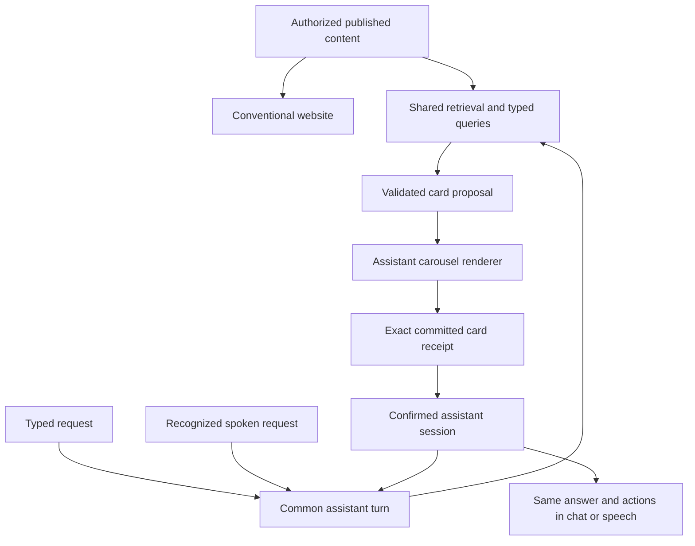

# Historical AI carousel study (superseded)

Status: **superseded September 18, 2026** by the [evolving information surface](../information-surface.md). The study below is a historical record, not current implementation guidance. Global slides, peeks, next/previous history controls and collapse-first Back no longer apply. The current surface restores whole answer states and retains related media in one composition.

Revision 2 incorporates the user's top-dock correction: preserve the current waveform/chat location, remove the added assistant header and bottom composer, and dismiss by clicking the softened background. This revision controls where it differs from the first interaction study.

This records the user's new direction. It supersedes whole-website conversational filtering as the intended visitor experience; the historical design review below describes the preimplementation state. The implementation report is authoritative for current runtime behavior and verification. Publisher content and deployment configuration remain unchanged.

## 1. Product contract

There are two visitor surfaces over the same authorized publication:

- **Website:** the existing native, Squarespace-style website, with its approved branding, layout, imagery, content and normal navigation. Its page, scroll and detail state belong to ordinary browsing.
- **Assistant:** the existing top waveform/chat area plus large carousel cards floating above the softened website. Voice and chat are input/output choices for one conversation. There is no additional assistant window, header or bottom dock.

AI queries change the carousel. They never filter, sort, scroll, collapse, replace or otherwise compose the website behind it. Closing the layer restores the page and position the visitor left. Reading the whole publication remains available to the assistant; observing the whole website does not.

The design borrows the original iPod's small vocabulary: **previous, next, open, back**. One item has emphasis. The path back is predictable. It does not introduce a click wheel, rotating 3D cards, automatic slide shows, nested horizontal carousels or a workspace full of floating panels.

## 2. What the visitor sees

### Website

Keep the website's existing composition and normal content interactions. Preserve the existing waveform's top location, geometry, colors and motion. Voice is the initial mode. A small **Chat** button at the lower-right edge of that interaction area switches to Chat; in Chat mode the same button reads **Voice**. This is one quiet mode switch, not a new navigation bar. Give the waveform an accessible Start/End conversation name without adding a competing visible entry button. Remember the chosen mode within this visit.

Clicking the waveform begins voice and brings the cards forward while the website recedes. The waveform stays at exactly the same top anchor throughout the conversation. Existing publisher greeting content and tone may seed an empty carousel. Permission and connection state remain truthful; loading the website or simply selecting Voice does not automatically start microphone capture.

Chat rests at that same top anchor. Clicking/focusing it opens the AI layer and glides the composer down into a comfortable typing position, reusing the current `ConversationDock` motion. Pressing Enter submits once and **immediately glides the composer back up**, while retrieval/model/render work proceeds. It does not wait for the answer or a display acknowledgment to return upward. Keep the prior useful cards during pending work. Clicking the resting composer again starts the next request.

This is a request composer, not a continuously displayed chat thread. Conversation memory remains shared internally. Useful written answers appear in information cards or as a clearly labeled answer within the active card; no bottom message stream or separate reply panel is introduced. Brief spoken answers may leave the current card unchanged. A small truthful pending/listening indicator may remain inside the top interaction area.

### Assistant

Only the following stay sharp above the background:

1. **The existing top interaction area:** the waveform or resting chat composer, its small Voice/Chat switch, and relevant connection/pending state.
2. **The cards:** one large active card and quiet adjacent-card edges. The title, type, relevant facts and any necessary controls live inside the card.

Remove the mockup's Back / publisher name / Website / X header, topic strip and bottom conversation dock. Do not add a panel behind the entire assistant. The normal website identity is still present in the softened background.

Previous/Next arrows and a quiet position such as **2 of 58** can live in the card's own lower edge. Expansion uses the same card, with a small in-card collapse/return control only when needed. Spoken/typed Back retains its navigation meaning. There is no permanent global Back button, history sidebar, transcript panel, filter form or extra dashboard chrome.

Desktop uses a generous central stage, approximately 880–1,200 CSS pixels wide when space permits. Image-led cards may have a two-part image/text layout. Mobile shows one card at a time with small adjacent-edge hints; content reflows rather than shrinking desktop typography. The layer uses the available viewport, with safe-area and keyboard space reserved. Longer text scrolls vertically inside the active reading card only.

Expanded content uses the same stage and card identity. It gains detail space without opening another floating window and always reserves the top interaction area. A comparison is one comparison card with clearly labeled subjects; a gallery becomes a carousel of individual photos. There is one level of horizontal movement at any moment.

### Click outside to return

Clicking/tapping the softened website outside the cards and top interaction area closes the entire AI layer, including from an expanded card. It stops microphone, spoken output and playing media, cancels pending work and restores the unchanged website and its scroll position. It retains the session, current carousel position and unsent draft for a later explicit return.

The backdrop consumes that click: it must not also activate a website link underneath. A swipe, text selection or drag that ends outside a card must not dismiss the layer. Waveform, composer, mode switch, card controls and video controls are protected interaction regions. Always leave a usable backdrop gutter on mobile; do not require a precise tiny hit target. Escape provides the same dismissal from any card or composer state, and an accessible backdrop control offers the same action without adding a visible X. Card expansion/return has its own in-card control and spoken Back.

### Navigation meanings

| Input | Result |
| --- | --- |
| Next / Previous, arrows or horizontal swipe | Adjacent item in the current carousel; stop at either end, never wrap silently |
| Open / Enter on a card | Expand that card or enter its child collection; save the parent position |
| Back | Collapse an expanded card, otherwise restore its parent carousel, otherwise the previous query, otherwise the assistant welcome |
| “Back to those results” | Restore the originating result set, criteria, order and selected position, skipping intervening detail levels |
| “The second one” | Second item in the current carousel's published ordering; global position, not the second mounted DOM node |
| “This” / “What am I looking at?” | The single committed active card and its active subview |
| “The one I was just looking at” | Last distinct committed card in visit history, including a jump to another result set |
| “What did you just mention?” | Most recent narrated reference, kept separately from the last visited card |
| “Show everything again” | Clear criteria within the assistant's current scope and show that carousel's complete result set |
| “Search the whole site” | Explicitly broaden the assistant query to the entire publication |
| “Start over” | Cancel work and return to the assistant welcome; old browsing context becomes inactive |
| Outside click / Escape / “Back to the website” | Close assistant, stop microphone/output/media, restore website page and scroll; retain the assistant session for resuming |
| Home / “Website home” | Close assistant and navigate to the configured website home |

The Previous button means adjacent item; Back means previous level. A row of swipes must not create dozens of Back steps. A new topic replaces the current carousel and records a return frame; an explicit refinement preserves that topic and updates its query. Opening details never resets filters. From any detail, a new query may replace the foreground directly.

If two comparison subjects or several candidate ancestors fit a spoken reference equally well, ask one brief question. Do not use decorative neighbor peeks or keyboard focus to guess the subject.

## 3. Published content becomes useful cards

The adapter consumes the same authorized published data as the website, not its rendered HTML. It preserves canonical identity, qualifications, links and approved media associations. It reuses material directly where possible and selects a useful presentation where necessary. It does not rewrite or republish the website.

| Published material | Assistant representation | Content the assistant can use |
| --- | --- | --- |
| Product, service, place, person, event | Information card; expand for facts and relationships | Name, published summary, typed facts/units, conditions and approved related references |
| Article, policy, menu, FAQ, free-form section | Reading card with intact headings and bounded continuation | Exact published blocks and offsets; distinguish summary from verbatim reading |
| Collection or large catalog | Query-backed carousel, optionally entered from a collection introduction card | Scope, predicates, sorting, canonical count, stable order and cursor handles |
| Photo or album | One photo per card; fit the full image on expansion | Approved caption, alt text, credit, depiction/example status and asset-specific description |
| Comparison | One card with named subjects; stacked subjects on small screens | Only comparable typed facts; retain unknowns and incompatible units |
| Chart or dashboard | A chart or compact dashboard card, expandable in the same stage | Published dataset, selected series/range, units and provenance; computed values remain tied to that dataset |
| Contact, hours, links or supported action | Focused information/action card | Exact public values, qualifications and registered capabilities |
| Authorized public document | Reading card and, only if separately public, an original-document link | Published text with source/page references; private originals remain inaccessible |
| Uploaded MP4, existing website video, or YouTube link | Video card in the same carousel, with an appropriate player, poster/title and playback controls | Published description, source identity, playback state/time, transcript segment when available and known coverage |
| Audio | Audio card with artwork, playback controls and transcript when available | Published description, source identity, playback state/time and known transcript coverage |
| Unsupported interactive embed | A useful explanation and approved source link | Published metadata; do not claim understanding of an opaque embed |

Ordinary site questions may be spoken without replacing the current card. A request to show information should produce or focus a card. Chat answers appear in the appropriate information card or a labeled answer area inside the existing card. Do not add a slide for every sentence or append a visible chat thread beneath the carousel.

### Capability gaps recorded during design

- `media.ts` is an image/album schema. `collection-space.ts` has paragraph, heading, link and image blocks. There is no native published video/audio record or player/transcript contract. Video is therefore an explicit additive capability in this design, not a claimed existing feature.
- Images have caption and alt fields, but these can be generic. Existing photo interpretation can produce reviewed descriptions. The current visitor task runner sends text context; an image on screen does not automatically give the reasoning model visual understanding.
- `visitorTaskContext` currently requires a catalog or v2 catalog publication. A universal carousel must also accept approved no-catalog sections, contact information and media via the existing `publishedWorkspace` source projection.

### Describing and reading media

Each card has a server-derived **content payload** for both rendering and discussion. The assistant reads this payload instead of trying to reverse-engineer pixels or website DOM text.

For a photo, use a useful reviewed description when present. If the visitor asks about visual details absent from that description, a bounded inspection capability may analyze **only the authorized active image**, keyed to its publication, asset and content revision. It must receive the image bytes or approved derivative, not merely an ID. Cache the result within the session, label it as a visual observation and retain uncertainty. An inspection response for a card that has since changed cannot narrate as if that old image were current. This capability needs implementation and separate bounded provider verification; this design makes no live calls.

Do not infer product identity, ingredients, availability or price from appearance. A visual description and publisher facts retain different authority. If analysis is unavailable, say what metadata is available and avoid fabricated descriptions.

Video is an ordinary carousel card: previous item might be a photo, the current item a video, and the next item text or a chart. It does not require a separate video section or a detour out of the assistant.

Support three source adapters behind the same card contract:

- **Uploaded MP4:** validate the file and codec/container support, retain private originals as appropriate, publish an explicitly authorized playable asset and optional poster. Proposed initial upload ceiling: 50 MB and 10 minutes per video, still inside the site's unchanged total storage allowance. This is a new video-specific limit, not an increase to billing/storage allowances or the existing image limit. Use a native player with authorized byte-range delivery; unsupported encoding gets a clear fallback. No automatic transcoding service is assumed.
- **Existing website video:** import/review the publisher's actual approved playable source or supported embed reference, with title/poster/description when available. Apply the existing public-source validation rules; do not copy arbitrary scripts or automatically download unbounded video files. An inaccessible/expired host remains an explicit media error.
- **YouTube link:** normalize a supported YouTube URL into an approved video identity and render the YouTube player in the card. Do not download/rehost the video. Use player events and controls for play, pause and position; restricted/removed/non-embeddable videos get an approved link fallback. A YouTube link does not itself grant access to a transcript or frame analysis.

The published media reference records source kind, identity, available duration, optional poster and optional approved transcript/captions. Controls report actual `playing`, `paused`, `ended` and seeked state. The AI can discuss the published description or transcript around the playhead. It can describe an unseen video frame only with a separately implemented, authorized frame-inspection capability; a timestamp alone is not visual evidence.

**Playback choice:** click to play is the default. The publisher can opt into muted autoplay on the newly active video card. Autoplay starts only after that card becomes active/ready, never on neighbor previews or while the layer is closed. An explicit user pause wins when revisiting it. If autoplay is blocked, show Play without retries. Audible playback requires the visitor's deliberate action. Previous/Next pauses the departing player and remembers its position; returning restores that position. A video ending does not advance the carousel by itself.

These behaviors fit the supported player controls/events in the [YouTube IFrame API](https://developers.google.com/youtube/iframe_api_reference). Browsers may block autoplay, so a visible Play fallback is part of the design, following [MDN's autoplay guidance](https://developer.mozilla.org/en-US/docs/Web/Media/Guides/Autoplay). No external player is loaded in the interaction study.

“Read this” uses exact published text and a bounded narration cursor. “Explain this” may summarize it. Long reading proceeds in interruptible segments and records where audible delivery stopped. Moving to another card stops the previous narration. Swiping alone does not trigger new narration. Explicit continued-reading mode may read the next card after a spoken Next.

Only the active media player may play. Leaving a media card pauses it and retains position. Starting audible video pauses assistant speech and microphone capture; the dock shows that pause. Muted autoplay can coexist with conversation. Pressing Talk pauses the video and resumes conversation. Closing the assistant stops all media/capture. This avoids competing audio and accidental requests from media playback.

## 4. A small, explicit awareness boundary

The AI knows **the carousel and its active card**. “Active” means the selected, committed card, not a claim about the visitor's eye gaze.

### State ownership

| Owner | State |
| --- | --- |
| Website component, client only | Route/anchor, scroll, normal website detail state and return focus target; never part of model screen context |
| Existing visitor session/task service | Publication, conversation, query/result handles, criteria, selections, current carousel, active card/subview, bounded navigation and confirmed display receipt |
| Assistant client projection | Pending operation, animation, local media load/playback state, measured active reading segment and projected state waiting for confirmation |

Extend the existing `VisitorTaskSession` with the sole assistant presentation contract and migrate the old presentation/navigation ownership into it. Do not retain independently writable website-query, task-result and adaptive-workspace presentations alongside the carousel. The shared renderer remains a controlled consumer; it must not become a second store.

The logical carousel is an immutable ordered result handle or a small explicit ordered set. It is distinct from the few cards currently mounted. A 10,000-item carousel can keep its complete order/count on the server, fetch 24 descriptors at a time and mount the active card plus at most one neighbor on either side. Offscreen cards are not reported as seen. Preserve the existing publication, pagination and count/coverage rules.

### Proposed context packet

Send one compact replacement packet with:

- Session/publication identity, operation ID, interaction generation and confirmed presentation revision.
- Layer state: opening, active, closing or closed; ready/pending/unavailable.
- Carousel identity, topic, result handle/revision, scope/criteria, total count and known coverage.
- Active card identity and revision, global position, type, title, expanded subview, exact visible block/field IDs or media selection/playhead.
- Mounted card identities with active/neighbor/load status. A neighbor is not the selected item.
- Last distinct visited card, the parent return target and last narrated reference/cursor.

Server hydration supplies the active card's actual published content, not client-invented facts. Send bounded neighboring summaries and history, with retrieval handles for the rest. Use the existing bounded session retention: up to eight query/return frames; keep a small last-visited ring of 24 references. Do not copy full articles into each frame. Explicitly report expiry/unavailable history instead of silently substituting another item.

Store the exact visible reading segment and the complete card's retrievable content separately. “Read this paragraph” refers to the active reading segment; “read the whole article” starts/continues the bounded full article. Controls maintain semantic segment IDs rather than continuously streaming pixels or geometry to the model.

### One request and confirmation path

1. Both modalities submit a completed user request with the same session and latest committed interaction revision. Typing interrupts spoken output and suspends capture while composing; partial voice transcripts never become separate filter operations.
2. One orchestrator resolves references and applies the same command interpreter, capability registry, validation, retrieval and query rules. Channel-specific work is transcription, speech delivery and formatting; it cannot independently choose a different view. Existing direct command shortcuts must live behind this shared boundary, not only in Chat.
3. Keep the last useful carousel while retrieving. A proposed replacement carries publication/generation/operation IDs. The model cannot activate it directly.
4. Render and confirm only the requested active card/subview. Wait for its content readiness and settled transition, with a bounded timeout. An image must load or be reported unavailable; a mounted placeholder is not proof that the requested photo appeared.
5. The server validates the receipt and stores the confirmed presentation. The same tool result includes the confirmed card and its content for the continuing assistant turn and speech adapter. Merely appending a vague scene note to a separate voice conversation is insufficient.
6. Announce display success only from that receipt. If confirmation fails or arrives for an old generation, preserve the useful view and report failure/cancellation truthfully. New input, manual navigation, outside dismissal, Home and publication changes invalidate older work and associated speech. Chat's return-to-top animation is input feedback, not a claim that its result has been displayed.

For the same finalized request and context, Voice and Chat must yield the same interpreted operation, ordered results, focus, history and facts. Wording/prosody may differ; speech recognition errors remain a separate input-quality issue. Acceptance must compare the shared outcomes, not claim stochastic prose is byte-identical.

### Manual navigation and inactivity

Previous/Next/Open/Back update the same presentation reducer and produce a compact committed-card event. Coalesce a fast swipe sequence to its final settled card; immediately cancel narration/work targeting the old focus. Before answering “this,” flush the latest interaction receipt. A reply tied to an older card cannot complete after a newer manual selection.

When the layer is closed, unmount its observation/transport subscriptions, abort pending work and stop voice. Keep only the bounded session reference for resuming. Do not send website scroll, visible sections, card positions or mutation summaries to the AI. Website analytics and normal lazy-loading may continue independently; they are not AI awareness.

Within the open layer, use card lifecycle callbacks, carousel selection and a small observer scoped to the active reading container. Retain document visibility as a lifecycle signal and an accessibility check that the requested card is actually exposed. No whole-body MutationObserver is needed for assistant awareness.

## 5. Motion, accessibility and recovery

- Open/close the layer over roughly 420–520 ms using the existing controlled Motion easing. A restrained opacity/scale treatment lets the website recede without reflowing it. On mobile, prefer a simple scrim over expensive full-page blur.
- Move adjacent cards horizontally over roughly 260–340 ms. Expand/return over roughly 420–520 ms with stable card identity. No bounce, extensive stagger or delayed text. Final timings should be checked in the real renderer.
- Keep the waveform at its current top anchor and mounted through activation. Chat shares that anchor, travels down only for composition and returns immediately on submission. Keep the mode switch at the interaction area's edge. Reserve media dimensions to prevent jumps; the current card remains readable while a replacement loads.
- The accessible active layer includes both the persistent top interaction area and the cards; the underlying website is inert. Keep focus inside those active regions while open. Escape/outside dismissal restores the original website focus and scroll. Do not remount the waveform to create the accessible boundary. Card expansion stays within the same layer.
- Arrow keys navigate when the carousel owns interaction, not while typing or adjusting a native media control. Enter opens the selected card; labeled buttons provide the same operations. Swipe must not consume vertical reading scroll.
- Reduced motion removes travel/blur and keeps identical state/confirmation rules. Only the active rich card remains interactive; neighbors have lightweight previews.
- Empty results occupy a calm card with the active criteria and an invitation to relax them through the same conversation. No new filter form. Failures retain the previous carousel and offer a deliberate retry; never automatic paid retries.
- No microphone permission, exhausted AI allowance or unavailable media must prevent returning to the website. Already loaded cards and the shared conversation context remain usable without displaying a transcript thread. Unsupported content gets an explicit fallback, not a blank slide.

## 6. Implementation map: retain, change, remove

These names refer to the inspected current source; proposed new names are labeled.

| Area | Planned work |
| --- | --- |
| `SiteExperience.tsx` | Separate the website host and assistant layer; remove task `beforeShow` behavior that drives website invocation, focus release and reset. Keep shared published identity/style inputs. Give ordinary website and assistant media independent interaction scope. |
| `VisitorWorkspace.tsx` | Extract its normal `PublishedWebsite` composition/callbacks without styling redesign. Remove `taskView`, `useWebsiteTasks`, filtering and result injection from this path. Retain useful content rendering adapters. Migrate assistant objects into the one carousel. |
| `PublishedWebsite.tsx`, `website-presentation.ts`, `WebsiteDesignReview.tsx` | Preserve native generated/imported website styling and publisher preview. Remove only AI-query composition inputs no longer used after separation; normal website details/gallery/navigation continue locally. |
| Proposed `AssistantLayer.tsx` and shared `AssistantCarousel.tsx` | Cards above an inert softened website, controlled active card, in-card navigation and outside-click/Escape return. Reuse the existing `VisitorVoiceStage`, `Waveform` and `ConversationDock` at their top anchor. No additional header or bottom dock; no provider/storage dependencies in the shared package. |
| `VisitorTasks.tsx`, `task-view.ts`, `visitor-task-store.ts` | Replace the website projection with the single carousel contract, apply/confirm lifecycle and bounded history. Reuse operation, revision and cancellation infrastructure. |
| `VisitorAssistant.tsx`, `visitor-chat-task.ts`, `visitor-realtime-control.ts`, `visitor-task-runner.ts` | Route both modalities through one assistant turn with the same command/reference/card behavior; speech consumes the confirmed outcome. Remove legacy whole-website presentation/navigation tools from this active path. |
| `use-task-viewport.ts`, `workspace-screen.ts`, `visitor-realtime-context.ts`, `use-visitor-session.ts`, request/context schemas | Replace website record scans and broad browse/scene context with a small carousel receipt. Remove whole-body and page-scroll reporting from the new visitor path. Keep helpers/contracts needed by `/lab`, Studio or remaining nonvisitor consumers until their callers are checked. |
| `catalog-query.ts`, `catalog-query-index.ts`, `catalog-repository.ts`, `visitor-capabilities.ts`, `visitor-query-command.ts` | Retain complete-publication query, typed constraints, unknown handling, identity dedup, paging and validated execution. Direct their results to card descriptors. |
| `visitor-published-content.ts`, `visitor-workspace.ts`, `visitor-task-context.ts` | Reuse bounded authoritative text/media retrieval. Add a common published-content adapter for no-catalog sites as well as v1/v2 publications. |
| Shared `MediaViews`, task/detail components, `AdaptiveWorkspace`, Motion/OpenUI compilation | Reuse appropriate renderers, typography, expansion primitives and validation. Remove the old multipanel visitor host, not shared behavior still used elsewhere. |
| `media.ts`, `collection-space.ts`, media validation/public routes | Add video/audio and asset-description contracts as a separately testable additive capability. Preserve image publication compatibility; no automatic reimport, re-analysis or republishing. |

Do not roll back the dirty checkout wholesale. Preserve unrelated edits and useful query/reading/ACK fixes. Trace imports and tests before deleting obsolete code/styles; remaining legacy test/lab consumers must have an explicit compatibility boundary rather than leaving two active visitor experiences.

## 7. Build order and acceptance

1. **Separate the surfaces.** Capture the existing website baseline; preserve its composition and normal interactions. Mount an inert-background assistant shell. Verify closing returns exactly to the saved page.
2. **Build the carousel and its single state contract with synthetic content.** Cover mixed cards, expansion, parent/query history, active/previous/narrated references, keyboard, mobile and reduced motion. Use no model yet.
3. **Connect existing published queries and readers.** Products, services, no-catalog prose/photos and the 10,000-record nested fixture must work. Test beyond-page queries, duplicate membership, unknown fields and full article continuation.
4. **Unify Chat and Voice execution and confirmed outcomes.** Identical finalized utterance fixtures exercise both adapters. Include delayed ACK, fast swipes, opening a new result from a detail, typing during speech, closing during work and returning after expiry.
5. **Add media intelligence and playable media.** Reuse reviewed image descriptions; add bounded active-image inspection and video/audio contracts with synthetic assets/transcripts. Keep absent transcript/frame knowledge explicit. Provider and microphone checks remain separately authorized and bounded.
6. **Remove the obsolete active path and document actual results.** No website-filtering render injection, background website screen reporting or parallel visitor workspace remains. Run the existing relevant unit/rendering/browser/build checks, then an isolated visual walkthrough.

### Required end-to-end walkthrough

From midway down a normal website: click the unchanged top waveform → inspect its stable position while the website softens → switch to Chat → click the resting composer → type a mixed-topic request → press Enter → observe the composer return upward before results finish → Next → Open → ask about this → Back → filter → broaden → open the second result → switch to Voice → ask what is showing → request the previously viewed card → return to results → click the background. The original page and scroll must be unchanged. Repeat with a photo, a long article, no matches, a failed image, and synthetic video.

Verify outside dismissal during voice connection, model work, card transition and expanded media. It must cancel stale work and consume the click. Verify swiping a card or adjusting a video control never dismisses accidentally. Escape must work with keyboard focus in the composer and within a card. Switching modes preserves the same carousel and history; opening Chat alone makes no model request.

The key regression is the user's reported failure: after “Show me chocolate,” the confirmed card and its grounded content must be present in the next spoken turn. Test the inverse too: an unacknowledged or cancelled display must never be described as shown. Switching channels must not create a second session or run the request twice.

### Historical design-only verification

The design is grounded in source inspection, not previous completion reports. It includes an isolated interaction study for the proposed card navigation and layering. That study uses illustrative content and local scripted behavior; it does not implement the production assistant, perform speech recognition, inspect real images, play actual video or verify provider behavior.

The first interaction study is `assistant-carousel.html` in this task's visualization directory. The controlling revised study is `assistant-carousel-top-dock.html`: it removes the extra frame/header/bottom composer and demonstrates the retained top waveform, compact mode switch, Chat composition/return motion, in-card controls and background dismissal. Both use illustrative copy and cake artwork rather than proposed publisher-content changes. Optional design controls include muted autoplay.

Static checks validate JavaScript syntax, document structure and design-file whitespace. No application check or live provider call is part of this design pass. Browser inspection was attempted, then authorized for the exact local preview by the user, but the browser URL policy still rejected that file URL. No alternate browser or server workaround was used. Consequently, the preview's layout, animation and interactions are **not browser-verified** in this task. Ports 3220, 3225 and 3227 were confirmed stopped.

The revised top-dock study passed JavaScript and CSS parsing and contains no network or microphone calls. Its waveform is a static visual approximation for the study; implementation must reuse the existing waveform component unchanged. Chat submission uses a short scripted pending interval to demonstrate the immediate return-to-top behavior, not a provider request. The earlier browser-policy restriction was not retried or bypassed for this revision.

Application tests are not rerun for this documentation/design-only change. Implementation readiness means the ownership, navigation, content mapping, removal boundary and acceptance plan are specified. It does not mean the new runtime is shipped or the reported voice failure is already fixed.
